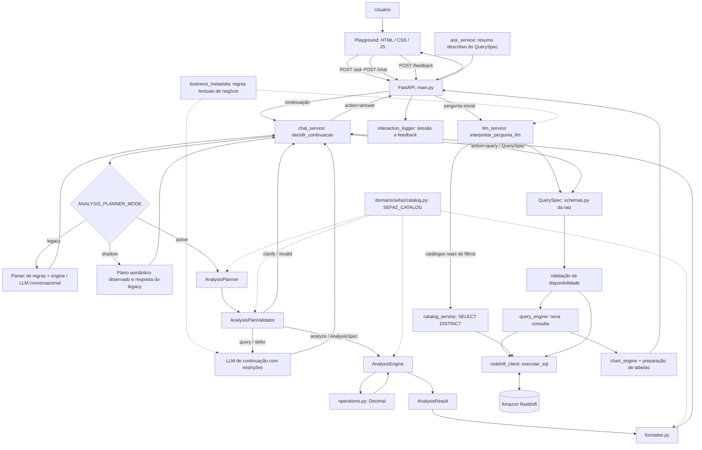
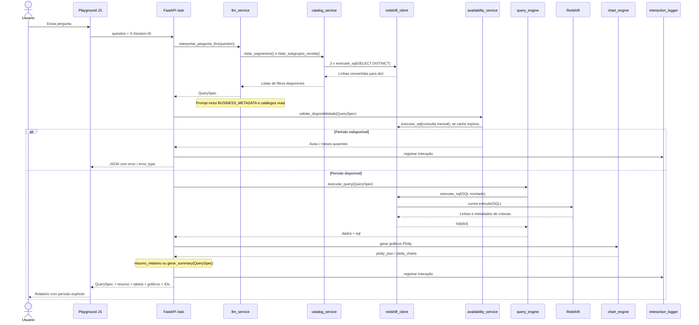
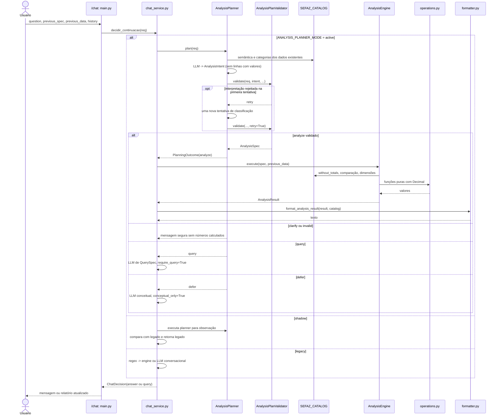

# Faro — Agente de Dados da SEFAZ

## 1. Visão geral

O **Faro — Agente de Dados da SEFAZ** é uma aplicação de consulta e análise conversacional de arrecadação tributária do Ceará. A solução usa **FastAPI** (API HTTP REST e Playground), **HTML/CSS/JavaScript** (interface), **OpenAI Responses API com modelos Pydantic** (interpretação de perguntas), **Amazon Redshift** (dados) e **Plotly** (gráficos). A aplicação expõe o SQL gerado, o `QuerySpec`, tabelas, gráficos e um resumo textual; depois da consulta inicial, aceita perguntas de continuação sobre o resultado.

A evolução da arquitetura separou três responsabilidades:

1. **Nova consulta:** linguagem natural → `QuerySpec` → verificação de meses disponíveis → `query_engine.py` → SQL executado no Redshift → relatório.
2. **Análise numérica dos dados já exibidos:** pergunta contextual → `AnalysisPlanner` (classificação por LLM) → `AnalysisPlanValidator` → `AnalysisSpec` → `AnalysisEngine`/`operations.py` (Python + `Decimal`) → `AnalysisResult` → `formatter.py`.
3. **Explicação conceitual ou pedido de novos dados:** o roteador de continuação distingue o que não é um cálculo disponível no contexto e, conforme o caso, solicita esclarecimento ou chama outra LLM com restrições específicas.

O contrato de **consulta à fonte (`QuerySpec`)** não é o mesmo contrato de **operação sobre resultados (`AnalysisSpec`)**. O pacote `analysis/` não executa SQL, não conhece `QuerySpec` e não depende de `ChatRequest`: recebe dados e regras de domínio por contratos explícitos. O vocabulário da arrecadação reside em `domains/sefaz/catalog.py`, enquanto o núcleo matemático é genérico.

> **Modo de operação:** `ANALYSIS_PLANNER_MODE` admite `legacy`, `shadow` e `active`; **sem configuração, usa `legacy`**. Logo, a existência do planejador semântico não implica sua utilização em cada sessão. O modo `legacy` ainda possui fallback de LLM com linhas numéricas. As garantias de isolamento dos cálculos devem ser interpretadas em função do modo (§ 4.2).

**Base desta documentação (26/10/2026):** foram conferidos os fontes enviados de `main.py` (versão da Etapa 2/recorte temporal), `schemas.py`, `llm_service.py`, `redshift_client.py`, `catalog_service.py`, `query_engine.py`, `chat_service.py`, `chart_engine.py`, `data_availability_service.py`, `interaction_logger.py`, **`business_metadata.py`, `ask_service.py`, `metadata_service.py`**, `analysis/{domain,engine,formatter,operations,planner,schemas,validator}.py`, `domains/__init__.py`, `domains/sefaz/{__init__,catalog}.py` e os arquivos HTML/CSS/JS do Playground entregues nesta conversa. O documento preserva o README previamente revisado e as alterações do autor. **A inspeção foi estática**: não houve execução ponta a ponta com credenciais reais nem auditoria da configuração de implantação e dos testes do repositório. **O endpoint `/metadata` permanece desatualizado** em relação ao `QuerySpec` (ver § 5.10).

## 2. Arquitetura em alto nível

A rota inicial `/ask` sempre segue o caminho de **consulta**. Em `/chat`, `decidir_continuacao()` escolhe como interpretar a continuação conforme o modo configurado: **legado**, **shadow** ou **active**. No modo ativo, a classificação pode terminar em análise determinística, esclarecimento, geração de novo `QuerySpec` ou explicação conceitual.



**Interpretação:** `legacy` é o caminho padrão; `shadow` executa a comparação interna e mantém a resposta legada; `active` aplica classificação e validação semânticas. `AnalysisPlanner` **não substitui** `llm_service.py` da pergunta inicial. O catálogo fiscal parametriza a parte analítica; o catálogo **não é** o executor de consultas SQL. No diagrama, a decisão `query` é convertida em um `QuerySpec` por uma chamada separada à LLM conversacional, antes de chegar ao mecanismo de consulta.

**Leitura do diagrama:** o fluxo combina rotas observadas em `main.py`, seleção de modos em `chat_service.py`, os serviços de consulta e a análise determinística. Antes de produzir o `QuerySpec` inicial, `llm_service.py` consulta os catálogos de valores de filtro no Redshift via `catalog_service.py`; isso é diferente do `SEFAZ_CATALOG` estático usado pelo motor analítico. A disponibilidade mensal é verificada antes da consulta principal. **Todos esses acessos SQL utilizam `redshift_client.executar_sql()`, agora inspecionado**, que abre uma conexão por chamada. O diagrama representa dependências lógicas, não todas as condições de erro.

## 3. Organização da solução

### 3.1. Estrutura principal

```text
MCP-SEFAZ-ARRECADACAO/
├── main.py                          # FastAPI; endpoints; tabelas/gráficos; logs
├── schemas.py                       # QuerySpec e AskRequest (consulta inicial)
├── llm_service.py                   # LLM para pergunta inicial; cliente _client
├── ask_service.py                   # Resumo descritivo determinístico do QuerySpec
├── chat_service.py                  # Orquestração real de continuidades e modos
├── business_metadata.py             # Texto estático com definições fiscais e exemplos para LLMs
├── catalog_service.py              # SELECT DISTINCT de segmentos/subgrupos para a LLM inicial
├── redshift_client.py              # Conexão redshift_connector e execução SQL em cursor
├── query_engine.py                  # SQL controlado por mapas e ramificações de relatório
├── chart_engine.py                  # Gráfico único ou 4 figuras de composição ICMS/FECOP
├── data_availability_service.py     # Verificação mensal com cache de 600 segundos
├── metadata_service.py              # Metadados estáticos legados/mock, desatualizados
├── interaction_logger.py            # JSONL diário, IDs, hash SQL e feedback
├── logs_interacoes/                 # Gerado em execução; não versionar sem política
├── analysis/
│   ├── domain.py                    # DomainCatalog + MetricDefinition + resolve_catalog
│   ├── schemas.py                   # AnalysisSpec, AnalysisResult, operações e status
│   ├── operations.py                # Primitivas matemáticas puras
│   ├── engine.py                    # AnalysisEngine, dados existentes, Decimal
│   ├── formatter.py                 # Mensagens determinísticas
│   ├── planner.py                   # AnalysisPlanner, AnalysisIntent, PlanningOutcome
│   └── validator.py                 # AnalysisPlanValidator, ValidationDecision
├── domains/
│   ├── __init__.py                  # default_catalog() -> SEFAZ_CATALOG
│   └── sefaz/
│       ├── __init__.py              # Reexporta SEFAZ_CATALOG
│       └── catalog.py               # SefazCatalog e SEFAZ_CATALOG
├── templates/
│   └── playground.html              # Estrutura do Playground
└── static/
    ├── css/playground.css           # Identidade visual
    ├── js/playground.js             # Estado, eventos, período, tabelas e Plotly
    └── images/faro.jpeg             # Avatar original
```

A estrutura mostra fontes anexados e imports de dependências; **não pretende listar todo o repositório**. `logs_interacoes/` é criado em tempo de execução. O conteúdo de `domains/__init__.py` foi confirmado: `default_catalog()` retorna `SEFAZ_CATALOG`. `analysis/schemas.py` (cálculo) e `schemas.py` da raiz (SQL/consulta) têm contratos distintos.

### 3.2. Separação de responsabilidades

| Camada | Módulos | Responsabilidade comprovada ou fronteira |
|---|---|---|
| Frontend | `templates/`, `static/` | Perguntas, interação, tabela, Plotly, período, feedback e avatar; sem decisão de negócio |
| API | `main.py` | Recebe `/ask` e `/chat`, executa decisões, prepara resposta, registra interações |
| Contrato de consulta | `schemas.py` (raiz) | `QuerySpec`, `AskRequest`; campos e `Literal` efetivamente definidos |
| Interpretação de nova consulta | `llm_service.py`, `business_metadata.py` | `responses.parse(text_format=QuerySpec)`; obtém segmentos/subgrupos reais por `catalog_service.py` e acrescenta instruções textuais de negócio a cada pergunta inicial |
| Continuação e migração | `chat_service.py` | Regras legadas, modo `shadow`, modo `active`, chamadas do planner, engine e roteador de LLM |
| Planejamento semântico | `analysis/planner.py` | LLM produz intenção estruturada sem acesso às linhas numéricas |
| Validação semântica | `analysis/validator.py` | Fundamenta categoria/métrica/escopo, pede esclarecimento, evita planos suspeitos |
| Contratos analíticos | `analysis/schemas.py` | `AnalysisSpec`, `AnalysisResult`, operações e estados |
| Núcleo analítico | `analysis/engine.py`, `analysis/operations.py` | Cálculo determinístico com `Decimal` sobre dados já recebidos |
| Texto do motor | `analysis/formatter.py` | Transforma `AnalysisResult` em texto, sem recalcular |
| Contrato de domínio | `analysis/domain.py` | Vocabulário e convenções parametrizáveis do motor |
| Domínio SEFAZ | `domains/sefaz/catalog.py` | Métricas A/B/C/D, aliases, decêndios, unidades e precedência fiscal |
| Disponibilidade | `data_availability_service.py` | Confirma meses com registros (não fechamento), cache de 10 min, aviso para mês corrente |
| Catálogos dinâmicos de filtros | `catalog_service.py` | Duas consultas `SELECT DISTINCT` à tabela consolidada, sem JOIN de decêndios e sem cache local |
| Consulta SQL | `query_engine.py` | Mapas de colunas, quatro caminhos SQL e construção de instruções; filtros textuais interpolados |
| Conexão com Redshift | `redshift_client.py` | `redshift_connector`, parâmetros por variáveis de ambiente, `cursor.execute(sql)`, conversão das linhas para dicionários e fechamento da conexão |
| Gráficos | `chart_engine.py` | Plotly simples, comparação e quatro gráficos fiscais A/B/C/D |
| Resumo da consulta | `ask_service.py`, `main.py` | Produz descrição determinística do `QuerySpec` para relatórios padrão; `main.py` compõe resumo próprio para ICMS/FECOP; nenhum deles recalcula valores dos registros |
| Metadados REST | `metadata_service.py` | Retorna dicionário estático de teste (`arrecadacao_mock`), **não alinhado** ao `QuerySpec` atual; não deve ser usado como catálogo oficial de capacidades |
| Observabilidade | `interaction_logger.py` | JSONL diário append-only, IDs UUID, vínculo, IP, hash de SQL, estatísticas e feedback |

## 4. Fluxos de execução

### 4.1. Pergunta inicial — `POST /ask`



Etapas principais:

1. O JavaScript captura a pergunta e faz `POST /ask` com o cabeçalho opcional `X-Session-ID`.
2. `interpretar_pergunta_llm()` consulta primeiro `listar_segmentos()` e `listar_subgrupos_receita()` em `catalog_service.py` (duas leituras `SELECT DISTINCT`, cada uma com sua conexão), inclui os valores retornados e `BUSINESS_METADATA` (texto estático de regras fiscais) no contexto e então chama a OpenAI Responses API com `text_format=QuerySpec` e `store=False`. O `QuerySpec` é validado estruturalmente; períodos comparativos invertidos são reordenados por início. As regras de negócio do prompt **orientam** o modelo, mas não equivalem a validadores formais do `QuerySpec`.
3. `validar_disponibilidade()` verifica **a existência de registros em todos os meses do intervalo**, por consulta agregada à fonte de arrecadação e cache de 600 s. Isso não confirma fechamento contábil, granularidade diária, existência do filtro solicitado nem cobertura de cada decêndio. Ausência de um mês interrompe o fluxo.
4. `executar_query()` escolhe entre agregado, comparação de períodos, série temporal e relatório fiscal `icms_fecop`. Constrói SQL com expressões de métricas/dimensões permitidas e delega a execução a `redshift_client.executar_sql()`: o cliente abre conexão, executa o SQL, converte o resultado para `list[dict]` e fecha a conexão no bloco `finally`.
5. `preparar_dados_tabela()` acrescenta linhas **Total geral** quando `group_by=decendio`, inclusive um subtotal por período no relatório fiscal comparativo. Os gráficos recebem o dado original, sem a linha artificial de total.
6. `preparar_graficos()` retorna `plotly_json` e, no relatório fiscal, uma lista `plotly_charts` com quatro figuras independentes.
7. `resumo_relatorio()` ou `gerar_summary(spec)` acrescenta **texto descritivo determinístico**. No relatório `standard`, `ask_service.py` descreve métrica, agrupamento, período, comparação, filtro de série temporal e configuração de gráfico **com base no `QuerySpec`, sem consultar dados nem chamar LLM**. Para `icms_fecop`, `main.py` produz outro texto com A/B/C/D. O resumo **não é análise estatística dos valores retornados** e pode não listar todos os filtros presentes.
8. `_finalizar_interacao()` inclui UUIDs de sessão/interação, registra o evento no JSONL diário e devolve o JSON ao navegador. Por padrão, esse evento tem hash do SQL, não o SQL literal.

**Tratamento de erros:** o endpoint `/ask` inclui falhas no próprio JSON com campos como `error` e `error_type`. Nem toda falha é exposta como status HTTP diferente de 200; clientes devem inspecionar também o corpo da resposta.

### 4.2. Pergunta de continuação — `POST /chat`

O navegador envia `question`, `previous_spec`, `previous_data` e `history`, além dos cabeçalhos opcionais `X-Session-ID` e `X-Parent-Interaction-ID`. Na versão inspecionada do JavaScript, a requisição contém **até 101 linhas** (`slice(0,101)`) e **até 8 trocas** recentes; o contrato Pydantic no servidor (`ChatRequest`) aceita até **500 linhas** e **20 itens de histórico**. Esses números representam limites distintos: o contrato do endpoint não é o mesmo que o envio adotado pela tela.

`main.py` chama `decidir_continuacao(req)`. O `ChatDecision` retornado por `chat_service.py` tem apenas `action='answer'|'query'`, com `answer`, `query_spec` e `origin` opcional (`deterministic`, `llm` ou `llm_query`). O JSON público de `/chat` também pode trazer **`action='error'`**, produzido pelo tratamento de falhas em `main.py`, mas **`error` não faz parte do modelo `ChatDecision`**.

#### 4.2.1. Três modos de operação

A função `_planner_mode()` lê `ANALYSIS_PLANNER_MODE`, normaliza para minúsculas e aceita exatamente `legacy`, `shadow` e `active`. Valor ausente ou inválido seleciona `legacy` (o inválido também gera warning).

| Modo | Encaminhamento implementado | Efeito para o usuário |
|---|---|---|
| **`legacy` (padrão)** | `_responder_deterministico()` identifica algumas operações por regex e usa `AnalysisEngine`; caso contrário `_decidir_com_llm()` interpreta o follow-up | Mantém o fluxo anterior. O fallback de LLM continua habilitado |
| **`shadow`** | Executa `AnalysisPlanner` e, quando pertinente, compara resposta semântica com resposta legada; registra ações/operações/equivalência | **Sempre devolve a decisão legada**; não usa o plano novo para produzir a resposta exibida |
| **`active`** | Executa `AnalysisPlanner` → `AnalysisPlanValidator` e despacha conforme `PlanningOutcome` | Novo encaminhamento governa análise, nova consulta, explicação ou esclarecimento |

O modo `shadow` não registra números/linhas nos logs de comparação; `_shadow_compare` registra operação antiga, ação/operação semântica, igualdade de texto (`answer_matches`) e razão de decisão. Falhas de planejamento em `shadow` preservam o legado. Falhas em `active` levam a mensagem segura de validação — **não liberam cálculo numérico livre pela LLM**.

Configuração de desenvolvimento para habilitar explicitamente o caminho semântico:

```powershell
$env:ANALYSIS_PLANNER_MODE = "active"
uvicorn main:app --reload
```

A aplicação não confirma por sua simples inicialização qual modo está definido em um `.env`: é necessário verificar a variável no ambiente real do processo ou os logs de `analysis_planner_decision` durante testes.

#### 4.2.2. Encaminhamento no modo `active`

`AnalysisPlanner.plan()` retorna um `PlanningOutcome`; ele **não é** uma ação JSON diretamente enviada ao navegador.

| `PlanningOutcome.action` | Comportamento implementado em `chat_service.py` |
|---|---|
| `analyze` | `_answer_semantic()` valida/seleciona métrica, executa `AnalysisEngine` e chama `format_analysis_result`; devolve `ChatDecision(action='answer', origin='deterministic')` |
| `clarify` | Responde com a pergunta de esclarecimento gerada pelo validador; nenhuma consulta/cálculo |
| `invalid` | Retorna mensagem determinística indicando que o plano não foi validado |
| `query` | Chama `_decidir_com_llm(require_query=True)` para obter novo `QuerySpec`; dados anteriores são omitidos do payload, e resposta `answer` inesperada é recusada com mensagem segura |
| `defer` | Chama `_decidir_com_llm(conceptual_only=True)`, para explicação conceitual; o payload contém `dados_atuais=[]` e `historico_recente=[]`, e há filtragem adicional de respostas com números |

Há ainda um ramo de compatibilidade para `defer` com `reason='no_complete_context'`, que retorna ao roteamento legado. Esse motivo **não é produzido nos módulos do planner/validator anexados**; a existência do ramo não comprova seu uso atual.

`_answer_semantic()` faz uma checagem independente da métrica explicitamente solicitada. Quando `AnalysisSpec.metric` vem ausente do plano, reutiliza a seleção contextual `_selecionar_metrica()` da Etapa 1, limitada às métricas efetivamente presentes. **A transição é híbrida:** o planejamento novo mantém uma rotina do legado para desambiguação de indicador, mas os valores permanecem calculados exclusivamente no `AnalysisEngine`.

#### 4.2.3. Fluxo legado/LLM e limites das garantias

No modo legado, `_op()` reconhece palavras-chave/expressões e `_responder_deterministico()` já usa o `AnalysisEngine` e o catálogo fiscal. Sem operação reconhecida, `_decidir_com_llm()` usa `CHAT_PROMPT`, `BUSINESS_METADATA` e `responses.parse(..., text_format=ChatDecision, store=False)` para decidir `answer` ou `query`. Esse fallback recebe **até 100 linhas numéricas** quando não está em modo restrito; portanto, a frase “a LLM nunca recebe números” **não é verdadeira para toda a aplicação ou para o modo legado**. A garantia mais forte de isolamento dos valores refere-se especificamente ao **`AnalysisPlanner`** e ao caminho conceitual restrito de `active`.

A chamada `require_query=True` omite linhas anteriores, porém mantém até 8 mensagens do histórico; elas podem conter valores textuais. O bloqueio de texto numérico em `conceptual_only=True` utiliza expressão regular e não deve ser descrito como uma validação formal de toda linguagem numérica possível.

O `main.py` processa `answer` como mensagem de chat (sem alterar o relatório) e `query` como nova consulta: `validar_disponibilidade()` → `executar_query()` → Plotly e tabela. Nesse segundo caso, a atualização do relatório não decorre do `AnalysisEngine`: exige dados novos.

**Estado conversacional:** `conversaAtual` e `historicoChat` permanecem no JavaScript e são enviados a cada follow-up. O registro de interações no backend é uma responsabilidade separada, e não prova persistência do histórico conversacional para recuperação automática entre sessões.

### 4.3. Avaliação das respostas — `POST /feedback`

O frontend permite voto **`positive`/`negative`** por interação, enviando `session_id`, `interaction_id` e `vote`. O servidor exige UUIDs válidos, procura a interação correspondente nos **até 90 arquivos JSONL diários mais recentes** encontrados e acrescenta um evento independente `event_type=feedback`. Quando não localiza a interação, a API retorna HTTP **404**; valores inválidos de voto são rejeitados pelo modelo Pydantic da API. O log não altera retroativamente o evento original (modelo append-only). A interface mostra o voto selecionado e o resultado do envio.

Exemplo de payload:

```json
{"session_id":"<UUID>","interaction_id":"<UUID>","vote":"positive"}
```

## 5. Contratos e endpoints da API

| Método | Rota | Objetivo |
|---|---|---|
| `GET` | `/` | Verificação simples de funcionamento (`API funcionando`) |
| `GET` | `/playground` | Servir a interface HTML do Faro |
| `GET` | `/static/...` | Servir CSS, JavaScript e avatar |
| `GET` | `/metadata` | Retornar **metadados estáticos de teste**; atualmente **não refletem** as dimensões e filtros suportados por `QuerySpec` |
| `POST` | `/ask` | Processar pergunta inicial em linguagem natural |
| `POST` | `/chat` | Processar continuação contextual |
| `POST` | `/feedback` | Registrar utilidade da resposta |
| `POST` | `/grafico` | Gerar dados de tabela e gráfico a partir de um `QuerySpec` |
| `POST` | `/grafico-html` | Renderizar o gráfico ou relatório em HTML Plotly |

O FastAPI também disponibiliza a documentação OpenAPI, normalmente em `/docs`, com a configuração padrão observada.

### 5.1. `QuerySpec`: contrato de consulta efetivamente definido

O modelo Pydantic está em `schemas.py` da raiz. **`metric` e `group_by` são obrigatórios**; vários demais campos possuem defaults, e **não existem validadores cruzados no próprio `QuerySpec`** para, por exemplo, exigir datas completas por tipo de análise. Parte dessas restrições é imposta pelos prompts, pelo serviço de disponibilidade ou pelos caminhos de SQL.

| Campo | Valores/tipo | Default |
|---|---|---|
| `metric` | `valor_arrecadado` ou `qtd_documentos` | obrigatório |
| `group_by` | `total`, `data_pagamento`, `mes`, `receita`, `codigo_receita`, `subgrupo`, `segmento`, `decendio` | obrigatório |
| `chart_type` | `bar` ou `line` | `bar` |
| `top_n` | `int` ou `null` | `20` |
| `order_desc` | `bool` | `true` |
| `analysis_type` | `aggregate`, `compare_periods`, `time_series` | `aggregate` |
| `report_type` | `standard` ou `icms_fecop` | `standard` |
| `months_back` | `int` ou `null` | `null` |
| `start_date`, `end_date` | string ISO de data ou `null` | `null` |
| `period_1_start/end/label` e `period_2_start/end/label` | strings ou `null` | `null` |
| `segmento`, `subgrupo`, `receita` | strings ou `null` (filtros) | `null` |
| `decendio` | `int` entre 1 e 3 ou `null` | `null` |

`AskRequest` contém somente `question: str` (sem limite de comprimento definido nesse modelo). O modelo `ChatRequest`, em `chat_service.py`, usa `question` de 1 a 2.000 caracteres, `previous_spec: QuerySpec`, `previous_data` com até 500 linhas e `history` com até 20 elementos. A interface envia no máximo **101 registros** e **8 turnos** por requisição de chat. `AnalysisSpec` não é uma variante de `QuerySpec`: representa uma operação sobre dados existentes (ver § 7.4).

**Significado temporal:** `period_1` é o período de referência (anterior), `period_2` é o avaliado (posterior); o serviço da pergunta inicial reordena os dois quando os inícios vêm invertidos. A diferença é `period_2 − period_1` e a variação percentual utiliza o primeiro período como referência. Decêndios não são calculados pela data na LLM: usam `dr.decendio` no SQL.

### 5.2. Estrutura da resposta

Em respostas bem-sucedidas de `/ask`, os principais campos observados são:

```json
{
  "question": "Mostre a arrecadação de ICMS ...",
  "query_interpretada": { "...": "QuerySpec serializado" },
  "summary": "Resumo textual da análise",
  "aviso_disponibilidade": null,
  "sql": "Consulta SQL utilizada",
  "title": "Título do resultado",
  "chart_type": "bar",
  "dados_brutos": [],
  "dados_tabela": [],
  "plotly_json": { "data": [], "layout": {} },
  "plotly_charts": null,
  "session_id": "<id>",
  "interaction_id": "<id>"
}
```

**Exemplo ilustrativo de estrutura**, não resposta capturada da API. Em relatórios `icms_fecop`, `plotly_charts` contém uma lista de figuras, em vez de `null`.

**Distinção importante:** `dados_brutos` é o resultado da consulta utilizado nos gráficos; `dados_tabela` pode conter linhas adicionais de totalização, construídas no servidor sem alterar os dados de origem dos gráficos.

### 5.3. Construção e execução SQL (`query_engine.py`)

A fonte base de **todas as quatro rotas SQL** é:

```sql
FROM arrecadacao.f_arrecadacao_diaria_consolidada a
INNER JOIN arrecadacao.decendios_regra dr
    ON dr.dat_pagamento = a.dat_pagamento
```

As expressões permitidas de métricas são `valor_arrecadado → a.vlr_arrecadado` e `qtd_documentos → a.qtd_dae_pag`. As dimensões válidas são mapeadas explicitamente para colunas (`data_pagamento`, `mes` por `DATE_TRUNC('month', ...)`, `receita`, `codigo_receita`, `subgrupo`, `segmento`, `decendio` por `dr.decendio`). `total` não é um agrupamento SQL: retorna uma linha de soma.

| Caminho em `executar_query()` | Condição / comportamento |
|---|---|
| `executar_relatorio_icms_fecop` | Tem prioridade quando `report_type='icms_fecop'`; aceita apenas `aggregate`/`compare_periods` e `group_by='total'/'decendio'`; restringe o subgrupo a ICMS |
| `executar_comparacao_periodos` | Para `analysis_type='compare_periods'`; seleciona duas somas condicionais e calcula no Python `diferenca`, `%` e `tendencia` |
| `executar_serie_temporal` | Para `analysis_type='time_series'`; agrupa por mês e opcionalmente aplica `months_back`, datas, filtros e decêndio |
| `executar_agregacao_simples` | Caminho padrão `aggregate`; `SUM` por dimensão ou um `total` único |

**Regras observadas:**

- Os filtros `segmento`, `subgrupo` e `receita` usam `LOWER(coluna) LIKE LOWER('%texto%')` nos caminhos padrão; o decêndio usa a classificação oficial `dr.decendio = 'N Decêndio'`, sem inferir datas. Para `icms_fecop`, o subgrupo é fixado em `ICMS`, e filtro por receita individual é proibido.
- As comparações padrão produzem **formato largo**: categoria, colunas nomeadas pelos `period_*_label`, `diferenca`, `variacao_percentual` e `tendencia`. O relatório ICMS/FECOP comparativo produz **formato longo**, com uma coluna `periodo` e os quatro indicadores, permitindo os gráficos agrupados. O `DomainCatalog` conhece ambos os formatos.
- `top_n` é aplicado ao agregado por dimensão; a comparação agrupada usa `LIMIT {top_n or 20}`, ordenando pelo segundo período (exceto decêndios); a série temporal não aplica `LIMIT top_n`. **Top-N não é um conjunto completo de todas as categorias** e não autoriza inferir totais globais das linhas exibidas.
- O SQL padrão utiliza comparação de datas `>= 'início'` e `<= 'fim'`; o relatório ICMS/FECOP faz parsing de datas ISO e utiliza intervalo semiaberto `>= DATE 'início'` e `< DATEADD(day, 1, DATE 'fim')`. Em fontes com hora, essas estratégias não são equivalentes: a segunda inclui todo o último dia.
- Na comparação padrão, ausências de soma são convertidas para `0` (`or 0`), o que não equivale à exigência de pares completos no motor analítico; no relatório fiscal, valores `NULL` podem permanecer `None` no Python. Há tratamento de referência percentual zero (`None`) e a tendência usa diferença de valores.
- As funções devolvem `{'dados': [...], 'sql': '...'}`; execução física é delegada a `redshift_client.executar_sql(sql)`, que chama **`cursor.execute(sql)` sem parâmetros de consulta**. A camada de consulta **não recebe SQL livre diretamente da LLM**, mas algumas strings de filtro e datas são interpoladas em SQL por f-strings, exigindo revisão de segurança antes de produção. O código também não contém validação cruzada que impeça períodos comparativos sobrepostos, algo a verificar nos usos reais.

### 5.4. Disponibilidade temporal (`data_availability_service.py`)

O serviço consulta somente `arrecadacao.f_arrecadacao_diaria_consolidada` (sem JOIN com regras de decêndio), obtendo meses `YYYY-MM` com `COUNT(*) > 0`; guarda o conjunto em cache por **600 segundos**, protegido por `Lock`. `validar_disponibilidade()` valida intervalos de datas, exige existência de registros em **todos** os meses solicitados e rejeita meses futuros. Para `time_series` com `months_back`, deriva o primeiro mês do período até hoje; com intervalo inexistente, devolve disponibilidade positiva sem uma checagem de período.

No mês corrente, informa que **os dados podem estar parciais**. A mensagem de ausência inclui até 12 ocorrências mês/período e informa que valores faltantes **não foram tratados como zero** nessa etapa. O mecanismo não verifica fechamento contábil, totalização diária, filtros específicos nem a presença de cada decêndio; a expressão “disponível” significa estritamente presença mensal na base.

### 5.5. Geração de gráficos (`chart_engine.py`)

- Relatório `standard` agregado ou série temporal: barras quando `chart_type='bar'`; linhas com marcadores quando `chart_type='line'`.
- Comparação padrão: barras lado a lado por categoria; se `group_by='total'`, duas barras, uma para cada período.
- `group_by='decendio'`: eixo ordenado como `1 Decêndio`, `2 Decêndio`, `3 Decêndio`.
- Relatório `icms_fecop`: quatro figuras (`icms_a`, `fecop_b`, `icms_sem_fecop_c`, `icms_liquido_tesouro_d`), com séries por período em comparações.

O `main.py` serializa as figuras Plotly em `plotly_json` e `plotly_charts`. A adaptação final de títulos para incluir o recorte temporal ocorre no **JavaScript do Playground**; portanto, consumidores diretos de `/grafico` ou `/ask` recebem o `layout` original do Python, sem necessariamente a anotação visual do navegador.

### 5.6. Acesso físico ao Amazon Redshift (`redshift_client.py`)

O cliente de banco **foi inspecionado**. O módulo chama `load_dotenv()` e utiliza `redshift_connector.connect()` em `get_connection()`, com os parâmetros abaixo. Cada chamada de `executar_sql(sql)` abre uma conexão, cria um cursor, executa a instrução **literal** com `cursor.execute(sql)`, lê `cursor.description` e `fetchall()`, devolve `list[dict]` no formato `{nome_coluna: valor}` e fecha a conexão em `finally`, inclusive se a execução/fetch falhar após conectar.

| Variável | Uso em `get_connection()` | Padrão observado |
|---|---|---|
| `REDSHIFT_HOST` | Endereço do cluster/endpoint | Sem padrão |
| `REDSHIFT_PORT` | Porta, convertida com `int(...)` | `5439` |
| `REDSHIFT_DATABASE` | Banco de dados | Sem padrão |
| `REDSHIFT_USER` | Usuário do banco | Sem padrão |
| `REDSHIFT_PASSWORD` | Senha do banco | Sem padrão |
| `REDSHIFT_SSL` | `ssl=` no `redshift_connector.connect` | `false` (desabilitado no código por padrão) |

`REDSHIFT_SSL` habilita o parâmetro `ssl` apenas para `1`, `true`, `yes` ou `on` (sem diferenciação de maiúsculas); os demais valores resultam em `False`. **A configuração de transporte e certificados precisa ser verificada no ambiente de implantação**; não se deve pressupor TLS habilitado pelo código quando essa variável está ausente.

**Comportamento e limites confirmados:** não há *pool* ou reutilização explícita de conexões, `timeout`/retry configurado neste módulo, parametrização do `cursor.execute`, restrição do texto SQL a `SELECT`, nem conversão específica de exceções do driver. O cursor não é fechado explicitamente, embora a conexão seja encerrada em `finally`. A construção dos SQLs utilizados pela aplicação está em outros módulos; **a função `executar_sql` é um executor genérico**, não um validador de SQL. Erros de conexão, execução ou leitura são propagados ao chamador (que pode traduzi-los ou não, dependendo do endpoint).

### 5.7. Valores de referência da LLM inicial (`catalog_service.py`)

Este serviço consulta diretamente `arrecadacao.f_arrecadacao_diaria_consolidada` e executa duas operações independentes:

- `listar_segmentos()`: `SELECT DISTINCT TRIM(dsc_segmento) AS valor`, descartando `NULL` e valores vazios, com ordenação crescente;
- `listar_subgrupos_receita()`: `SELECT DISTINCT TRIM(receita_class_subgrupo) AS valor`, também descartando `NULL`/vazios e ordenando.

Ambas usam `redshift_client.executar_sql()`, **sem JOIN com `decendios_regra` e sem cache nesse módulo**. São chamadas sequencialmente em `interpretar_pergunta_llm()` antes da requisição à OpenAI. Portanto, uma pergunta inicial geralmente envolve **duas leituras de catálogos**, mais a consulta de disponibilidade (caso o cache mensal precise ser atualizado) e a consulta principal após a interpretação. Cada leitura usa sua própria conexão pelo cliente atual. Falha na leitura de qualquer catálogo impede a conclusão normal da interpretação inicial; `/ask` a trata como falha na etapa de interpretação.

**Distinção arquitetural indispensável:** `catalog_service.py` fornece **valores atuais de filtros presentes no banco** para contextualizar a LLM (`segmento` e `subgrupo`). Já `domains/sefaz/catalog.py` define o **`SEFAZ_CATALOG` estático**, com métricas, aliases, unidades e semântica fiscal usados pelo motor analítico. São catálogos com **propósitos diferentes**, não duas versões da mesma fonte de verdade. Também não há demonstração de que uma lista incluída no prompt seja revalidada contra o banco antes do SQL; o `QuerySpec` aceita filtros de texto e o serviço de consulta os aplica.

### 5.8. Regras e vocabulário enviados às LLMs (`business_metadata.py`)

O módulo exporta **uma constante textual** `BUSINESS_METADATA` (string multilinha). Ela é concatenada ao *system prompt* tanto em `llm_service.py` (pergunta inicial) quanto em `chat_service.py` (LLM de continuação). Não é um serviço que consulta o banco, nem um validador de regras de negócio e **não é a mesma estrutura** que o objeto tipado `SEFAZ_CATALOG`.

Seu conteúdo documenta, em linguagem destinada ao modelo:

- **Segmento econômico** (`dsc_segmento`): filtro `segmento` e agrupamento `group_by='segmento'`; não aplicar filtro quando se pede todos os segmentos.
- **Subgrupo da receita** (`receita_class_subgrupo`): filtro `subgrupo` e agrupamento `group_by='subgrupo'`; um subgrupo pode reunir várias receitas.
- **Receita individual** (`dsc_receita`): filtro `receita` e agrupamento `group_by='receita'`; não transformar a palavra genérica “receita” em filtro nem pressupor `receita='ICMS'` quando ICMS é subgrupo.
- **Total consolidado**: `group_by='total'`, sem dimensão de agrupamento.
- **Decêndios oficiais**: relação pela coluna `dat_pagamento` com `arrecadacao.decendios_regra`; `group_by='decendio'` para exibir os três e `decendio=1|2|3` com `group_by='total'` para um único decêndio. **Não deduzir** início/fim de decêndios a partir de datas ou dias úteis.
- **Composição ICMS/FECOP**: subgrupo ICMS e campos A (`icms_a`), B (`fecop_b`, parcela com `tip_fecop=1`), C (`icms_sem_fecop_c = A-B`) e D (`icms_liquido_tesouro_d = 0,60×C`); relatório `icms_fecop` suporta apenas `aggregate`/`compare_periods` e `total`/`decendio`.

O texto instrui ainda a **não confundir dimensão com filtro**, não inventar nomes de classificação e não tratar período ausente como arrecadação zero. Trata-se de **contexto para interpretação**, não de código que imponha essas regras: a validação efetivamente executada pertence aos contratos e aos serviços Python. A implementação fiscal do SQL e as regras do `SEFAZ_CATALOG` devem permanecer coerentes com esse texto; o código não possui sincronização automática entre essas três representações.

### 5.9. Resumo descritivo determinístico (`ask_service.py`)

`gerar_summary(spec: QuerySpec) -> str` **não chama LLM, não consulta o Redshift e não lê as linhas resultantes**. A função utiliza rótulos locais para `valor_arrecadado`, `qtd_documentos` e para cada dimensão do `QuerySpec`, gerando uma frase conforme o tipo de análise:

| Tipo | Conteúdo realmente produzido |
|---|---|
| `time_series` | Série temporal mensal da métrica, número de meses (`months_back`) quando presente, filtros textuais de segmento/subgrupo/receita e tipo de gráfico |
| `compare_periods` | Comparação de totais ou por dimensão entre os **rótulos** `period_1_label`/`period_2_label`, com menção a diferença, variação percentual e tendência |
| `aggregate` | Métrica e agrupamento, período quando `start_date` e `end_date` existem, `top_n` quando não nulo e tipo de gráfico |

No fluxo `/ask` e em nova consulta `/chat`, o `main.py` chama `resumo_relatorio(spec)`: se `report_type != 'icms_fecop'`, delega a `gerar_summary`; se é `icms_fecop`, constrói um resumo próprio com A, B, C e D e o recorte/agrupamento.

**Limite importante:** esse resumo descreve **a interpretação**, não o resultado numérico. Por exemplo, a frase sobre “cálculo de diferença e tendência” não corresponde a um texto gerado a partir dos valores da tabela. Alguns filtros (como `decendio` em todos os ramos e `segmento` em certos ramos) não aparecem explicitamente no resumo; no agregado `group_by='total'`, pode mencionar `top_n` mesmo sem existir `LIMIT` SQL para um total consolidado. Para inspecionar o pedido executado, usar `query_interpretada` e SQL, e não apenas o resumo.

### 5.10. Endpoint de metadados estáticos e divergência com os contratos (`metadata_service.py`)

`GET /metadata` chama `get_metadata()`, que devolve **um dicionário literal fixo**, sem consultar `QuerySpec`, `DomainCatalog` ou Redshift. O conteúdo atual ainda descreve uma **API de teste**:

- `dataset: 'arrecadacao_mock'` e descrição de API de teste;
- métricas `valor_arrecadado` e `qtd_documentos` (ambas com agregação `sum`);
- opções de agrupamento `mes` e **`municipio`**;
- tipos de gráfico `line` e `bar`;
- filtros `municipio`, `start_mes`, `end_mes`, `top_n` e `order_desc`.

**Divergência comprovada:** o `schemas.py` atual **não aceita `group_by='municipio'`**, nem define os filtros `municipio`, `start_mes` ou `end_mes`; por outro lado, suporta `total`, `decendio`, `segmento`, `subgrupo` e outras opções ausentes desse endpoint. Assim, `/metadata` **não é fonte autoritativa das capacidades da aplicação**. Um consumidor que tente gerar `QuerySpec` a partir dele pode solicitar parâmetros inválidos ou deixar de descobrir funcionalidades existentes. Recomenda-se substituí-lo por metadados gerados/validados a partir dos contratos reais; **essa correção ainda não foi implementada** nos arquivos analisados.

## 6. Camada de apresentação — Faro

A identidade do Faro foi incorporada sem recriar o avatar enviado. Posteriormente, o Playground deixou de ser uma string HTML embutida no `main.py`: `GET /playground` lê `templates/playground.html` e o FastAPI monta `StaticFiles` em `/static`. O backend continua servindo a API, enquanto HTML, CSS, JavaScript e imagem ficam independentes.

### 6.1. Componentes de frontend

- **`playground.html`**: entrada da pergunta inicial, chips de exemplos, áreas de `QuerySpec`, SQL, resumo, dados, tabela, gráficos, avaliação e chat.
- **`playground.css`**: identidade visual, responsividade, grade de gráficos, tipografia, tabelas e avatares.
- **`playground.js`**: `fetch('/ask')`, `fetch('/chat')`, `fetch('/feedback')`, gerenciamento local da conversa, construção da tabela e gráficos, formatação numérica `pt-BR` e atualização do recorte temporal.
- **`static/images/faro.jpeg`**: arquivo original apresentado na abertura e como avatar circular discreto (38 px) junto às respostas.

Após uma primeira consulta **bem-sucedida**, `faroWelcome` é ocultado; a área principal de entrada continua na tela. O JS mantém `conversaAtual`, `historicoChat`, `sessaoId` e `ultimaInteracaoId` em memória do navegador e envia contexto ao servidor; não foi implementada, nos arquivos verificados, uma recuperação automática desse estado após recarregar a página.

### 6.2. Recorte temporal associado aos resultados

O JavaScript constrói o texto de período a partir do `query_interpretada` da resposta, **não** do enunciado livre. Exibe-o junto às seções de tabela/gráficos e o acrescenta ao `layout.title` das figuras Plotly. Comparações mostram os dois períodos; intervalos mensais completos podem aparecer como nome do mês; intervalos parciais usam datas. Uma continuação que retorna nova `query` atualiza também o rótulo do período.

Exemplos: `Período: dezembro de 2025`; `Comparação: setembro de 2025 × setembro de 2026`. Se o `QuerySpec` não fornecer datas aplicáveis, o frontend dispõe de texto indicando período não informado. O código não calcula o período a partir das linhas da tabela. Essa evolução é exclusivamente visual, sem alterar SQL ou resultados.

### 6.3. Tabelas e Plotly

A resposta pode conter `plotly_json` para gráfico único ou `plotly_charts` com **quatro figuras** para o demonstrativo ICMS/FECOP. A interface exibe grade responsiva e valores numéricos formatados para pt-BR. O servidor separa `dados_brutos` (consultados, usados pelos gráficos) de `dados_tabela` (que pode acrescentar totalizações de decêndios).

No demonstrativo fiscal, os cálculos estão efetivamente implementados **no SQL**, com os significados:

- **A — `icms_a`**: `SUM(a.vlr_arrecadado)` somente sobre registros do subgrupo ICMS;
- **B — `fecop_b`**: `SUM(CASE WHEN a.tip_fecop = 1 THEN a.vlr_arrecadado ELSE 0 END)` dentro do mesmo subgrupo;
- **C — `icms_sem_fecop_c`**: `A − B`;
- **D — `icms_liquido_tesouro_d`**: `0,60 × C`.

Essas expressões descrevem o SQL fornecido; não substituem a validação dos indicadores com dados de referência da SEFAZ. O `chart_engine.py` constrói quatro gráficos de barras de forma independente; nas comparações, utiliza uma série por período e pode exibir apenas categorias efetivamente encontradas.

## 7. Motor analítico: etapas, contratos e separação de responsabilidades

Esta seção documenta a evolução **efetivamente implementada** nos arquivos de `analysis/` e sua integração **confirmada** no `chat_service.py`. A questão essencial é a distinção entre o contrato da consulta (`QuerySpec`) e o contrato de operação sobre os dados já retornados (`AnalysisSpec`). A configuração de modo define se o novo fluxo é usado, observado ou ignorado.

### 7.1. Por que um segundo caminho analítico?

| Pergunta | Tipo real de trabalho | Caminho |
|---|---|---|
| “Mostre a arrecadação por segmento em abril de 2026” | Obter informações da fonte | `QuerySpec` → Redshift → relatório |
| “Qual segmento mais arrecadou nessa tabela?” | Encontrar extremo nos dados atuais | `AnalysisIntent` → validação → `AnalysisEngine` |
| “Qual a diferença entre o maior e o menor?” | Calcular amplitude nos dados atuais | Operação `amplitude`, sem SQL adicional |
| “Agora compare com março” | Obter outro recorte | `query` → nova geração de `QuerySpec` |
| “Qual foi a variação percentual?” sem categoria inferível | Esclarecer o alvo | `clarify`, sem palpite e sem cálculo livre |

O processamento analítico é determinístico, mas **não é uma ferramenta de consulta completa**: trabalha sobre os registros entregues pela aplicação e respeita os limites de completude dessa amostra.

### 7.2. Evolução em três etapas

| Etapa | Entregas | Consequência técnica |
|---|---|---|
| **1 — Execução determinística** | `analysis/schemas.py`, `engine.py`, `operations.py`, `formatter.py`; adaptação do parser do `chat_service.py` | Desacopla a aritmética da interpretação da frase e do acesso a dados; permite testes isolados |
| **2 — Planejamento semântico** | `AnalysisPlanner`, `AnalysisIntent`, `AnalysisPlanValidator`, `PlanningOutcome`; modos `legacy`, `shadow`, `active` em `chat_service.py` | Separação entre classificação por LLM, validação determinística e execução; suporte a reclassificação e esclarecimento seguro |
| **3 — Desacoplamento de domínio** | `DomainCatalog`, `MetricDefinition`, `resolve_catalog`, `SefazCatalog`, `SEFAZ_CATALOG`; uso explícito de catálogo nos módulos | Retira do núcleo matemático as métricas/aliases/regras fiscais e permite injeção de outros catálogos sem mudar as primitivas matemáticas |

**Testes:** o histórico do projeto registra 55/55 testes e 98% de cobertura após a Etapa 1 e êxito de testes da Etapa 2; as baterias 2 e 3 da Etapa 3 apresentaram problemas posteriormente. Esses números **não foram reexecutados nesta revisão** e não são atestado de regressão da versão anexada.

### 7.3. Fluxo concreto do planejador até a resposta



A sequência `AnalysisPlanner` → `AnalysisPlanValidator` → `AnalysisEngine` → `formatter.py` está implementada e **ligada ao chat**, mas **somente governa a resposta quando o modo é `active`**. Em `shadow`, os resultados são comparados e descartados para a resposta ao usuário.

### 7.4. Contratos que não devem ser confundidos

| Contrato | Definição | Finalidade |
|---|---|---|
| `QuerySpec` | `schemas.py` da raiz | Escopo/filtros/períodos/agrupamento de uma **nova consulta**; não é produzido pelo `AnalysisEngine` |
| `ChatRequest` | `chat_service.py` | `question`, `previous_spec`, `previous_data`, `history` |
| `ChatDecision` | `chat_service.py` | Saída `answer` ou `query`, com texto ou `QuerySpec` e origem opcional |
| `AnalysisIntent` | `analysis/planner.py` | Proposta **não validada** da LLM: `analyze`, `query` ou `defer`, operação, métrica, categoria e origem da referência |
| `ValidationDecision` | `analysis/validator.py` | Decisão determinística `analyze`, `query`, `defer`, `clarify` ou `retry` |
| `PlanningOutcome` | `analysis/planner.py` | Resultado do planejamento: `analyze`, `query`, `defer`, `invalid` ou `clarify` |
| `AnalysisSpec` | `analysis/schemas.py` | Parâmetros de **operação numérica** sobre dados apresentados |
| `AnalysisResult` | `analysis/schemas.py` | Resultado/estado estruturado com valores `Decimal | None` |

O `AnalysisSpec` inclui `operation`, `metric`, `category`, `explicit_category`, `group_by`, `analysis_type`, `report_type`, `period_1_label`, `period_2_label` e `others_named`. **Não tem dependência do modelo `QuerySpec`**, ainda que o orquestrador copie alguns campos do contexto anterior para formar o plano.

As operações previstas em `AnalysisOperation` são:

```text
outros; amplitude; maximo; minimo; valor; diferenca; variacao;
variacao_percentual; crescimento_max; crescimento_min;
crescimento_max_percentual; crescimento_min_percentual
```

### 7.5. `AnalysisPlanner`: LLM como classificador semântico

`AnalysisPlanner.plan(req)` recebe a pergunta de continuação e o contexto anterior. Remove linhas de total via catálogo, detecta métricas numéricas disponíveis, enumera categorias da dimensão atual, e monta um payload contendo `group_by`, `analysis_type`, `report_type`, períodos e rótulos, `top_n`, domínios, `dados_truncados`, `dados_vazios` e **somente a última troca conversacional**.

A função `_safe_last_turn()` mascara montantes com `R$` e percentuais na última resposta. O planner **não recebe as linhas numéricas da tabela**, mas recebe rótulos de categoria (que podem conter números como parte de identificadores), períodos e outros metadados. `AnalysisIntent` tem validação Pydantic `extra="forbid"`, operações tipadas e coerência entre `action`, `operation`, `metric` e `category_source`.

A LLM é chamada via `_client().responses.parse()` com `text_format=AnalysisIntent` e `store=False`. Modelo: `ANALYSIS_PLANNER_MODEL`, ou `OPENAI_MODEL`, com padrão `gpt-4.1-mini`. O planejador realiza **no máximo duas classificações**: uma primeira tentativa e uma reclassificação se a validação do esquema ou do plano requerer. Se a classificação falhar ou continuar ambígua, pode solicitar esclarecimento ou executar uma recuperação **restrita a operações inequívocas**, sem recalcular números nem produzir SQL.

**Nuance:** o planner não garante, por si só, que os dados da tabela não cheguem a nenhuma LLM do sistema; o roteador conversacional legado é um caminho distinto. No modo `active`, a execução `analyze` devolve números apenas calculados no motor.

### 7.6. `AnalysisPlanValidator`: semântica fundamentada

O validador usa a pergunta atual, o **último turno** do histórico, as categorias efetivamente apresentadas e a semântica do domínio. Entre suas garantias no escopo implementado estão:

- **Mudança de recorte:** `query` sem evidência de novo período, dimensão, filtro ou gráfico desencadeia reclassificação e, se persistir, esclarecimento, sem conversão automática para análise.
- **Categoria atual prevalece:** um referente mencionado explicitamente na pergunta atual substitui referência inferida da última resposta.
- **Contexto comprovável:** referência `previous` precisa ocorrer na **última** troca; não vasculha todo o histórico em busca de um alvo arbitrário.
- **Ranking global:** não assume como categoria-alvo o vencedor anterior; rejeita ou remove categorias não fundamentadas conforme o escopo.
- **Consistência das operações:** crescimento só em comparação de períodos; `outros` exige categoria explicitamente mencionada e período único; variação de uma categoria exige categoria identificável; máximo/mínimo em comparação exigem uma categoria.
- **Múltiplos referentes:** quando a pergunta especifica mais de uma categoria para uma operação que exige apenas uma, pede esclarecimento.
- **Reparo conservador:** `recover_unambiguous()` só recupera três formatos verificáveis — amplitude global, valor de categoria explícita e continuação percentual com uma categoria comprovada na última troca.

O validador pode normalizar nomes de categorias e corrigir a operação para `amplitude` quando a pergunta é inequívoca, mas **não altera os números, períodos ou métricas** da consulta anterior. `clarify` não encaminha cálculo à LLM.

### 7.7. `AnalysisEngine` / `operations.py`: núcleo matemático reutilizável

`AnalysisEngine.execute(spec, linhas)` usa `Decimal(str(valor))`, rejeita booleanos e valores não numéricos e opera somente sobre registros recebidos — sem Redshift, LLM, `ChatRequest` ou `QuerySpec`.

| Função em `operations.py` | Cálculo |
|---|---|
| `rank_values` | Máximo/mínimo por categoria; empate preserva primeira ocorrência |
| `amplitude_values` | Valor maior menos valor menor |
| `sum_others` | Categoria explícita versus soma das demais |
| `period_changes` | `período_2 − período_1` e `(período_2 − período_1) / período_1 × 100` |
| `extreme_period` | Qual dos dois períodos tem maior/menor valor para uma categoria; empate do máximo favorece o segundo, do mínimo o primeiro |

A função `_forma_dados()` aceita comparação **larga** (valores de dois períodos em colunas) ou **longa** (categoria, campo `periodo` e valor por período). Ambas rejeitam duplicidades e valores incompletos; **ausência não é zero**. O catálogo define quais relatórios usam comparação longa e como excluir totais artificiais.

Seguranças e limites:

- `len(linhas) >= 101` retorna `too_many_rows`: resultado potencialmente truncado não pode sustentar cálculo completo.
- Linhas de `Total geral` são excluídas para evitar dupla contagem, conforme `total_row_field` e `total_row_label`.
- Categoria inexistente, métrica ausente, par de períodos incompleto ou operação incompatível devolvem estados explícitos, não números inventados.
- Divisão percentual com referência zero é indefinida, não `0%`.
- **Até 100 linhas não provam conjunto completo**: um resultado originalmente limitado por `top_n` também pode representar apenas um recorte das categorias existentes.

O motor é reutilizável em termos de **cálculo**, mas seu uso em outro contexto ainda exige catálogo, fonte de dados, contrato da consulta e orquestração adequados.

### 7.8. `AnalysisResult` / `formatter.py`: texto sobre valores já calculados

`AnalysisResult` contém `spec`, `status`, `metric_name`, `category`, `counterpart`, `selected_period` e `values: dict[str, Decimal | None]`. O formatador transforma esse contrato em mensagens `pt-BR`, usando unidades e rótulos do catálogo e os valores já computados no engine. Ele **não refaz cálculos**.

Estados incluem `ok`, `too_many_rows`, `metric_required`, `invalid_data`, `category_required`, `category_not_found`, `comparison_period_required`, `percent_reference_zero`, `all_percent_references_zero`, entre outros. A interface recebe resposta textual para esses estados; não precisa tratar cada status interno como erro HTTP.

### 7.9. `DomainCatalog` e implementação fiscal concreta

`analysis/domain.py` define um contrato sem conhecimento fiscal: `MetricDefinition(label, aliases, unit)` e `DomainCatalog(id, metrics, dimensions, metric_priority, derived_numeric_fields, long_comparison_reports, total_row_field, total_row_label, period_field, category_aliases, dimension_aliases, report_metric_aliases, currency_symbol, metric_prompt, metric_question, default_context_metric_reports)`.

`domains/sefaz/catalog.py` implementa **`SefazCatalog(DomainCatalog)`** e instancia **`SEFAZ_CATALOG`**, com `id='sefaz_ce_arrecadacao'`. O `__init__.py` de `domains/sefaz/` reexporta `SEFAZ_CATALOG`.

**Métricas concretas do domínio:**

| Campo | Rótulo | Unidade |
|---|---|---|
| `icms_a` | ICMS bruto (A) | moeda |
| `fecop_b` | FECOP (B) | moeda |
| `icms_sem_fecop_c` | ICMS sem FECOP (C) | moeda |
| `icms_liquido_tesouro_d` | ICMS líquido Tesouro (D) | moeda |
| `valor_arrecadado` | arrecadação | moeda |
| `qtd_documentos` | documentos pagos | contagem |

O catálogo estabelece a semântica **A = ICMS bruto incluindo FECOP; B = FECOP; C = A − B; D = 60% de C**. Os campos A/B/C/D são **calculados no SQL de `executar_relatorio_icms_fecop()`**, confirmado em `query_engine.py`; o núcleo analítico não refaz essa regra fiscal. O demonstrativo SQL filtra `receita_class_subgrupo = 'ICMS'` e utiliza `tip_fecop = 1` para obter B.

Dimensões permitidas no catálogo: `decendio`, `mes`, `data_pagamento`, `receita`, `codigo_receita`, `subgrupo`, `segmento`, `total`.

Regras de domínio realmente implementadas:

- Decêndios com nomes canônicos `1 Decêndio`, `2 Decêndio`, `3 Decêndio`, aliases como “primeiro decêndio”, e **nenhuma inferência de decêndio a partir de datas**.
- `segmento` admite “setor/setores”; outras dimensões também têm aliases específicos.
- `report_metric_aliases={'standard': {'icms_a': 'valor_arrecadado'}}`: referência a ICMS pode ser remapeada para a métrica padrão no relatório `standard`.
- `long_comparison_reports={'icms_fecop'}`: relatório fiscal usa representação de comparação longa.
- `total_row_field='decendio'` e `total_row_label='Total geral'`: evita tratar subtotal de tabela como categoria analítica.
- `derived_numeric_fields` exclui `variacao_percentual`, `diferenca`, `qtd_registros`, `codigo_receita` e `periodo` da detecção automática de métricas.
- `SefazCatalog.mentioned_metrics()` **sobrescreve** a implementação genérica para preservar precedência e aliases fiscais ambíguos: “sem FECOP” → C; “líquido/tesouro” → D; “FECOP” → B; “ICMS” → A se presente, senão `valor_arrecadado` quando disponível.

O catálogo é imutável na interface pública (`dataclass(frozen=True)`) e usa `MappingProxyType` nos mapas, reduzindo risco de alterações acidentais entre chamadas. `resolve_catalog(catalog)` usa o catálogo **explicitamente injetado** ou, sem argumento, chama `domains.default_catalog()`; a implementação de `domains/__init__.py` foi inspecionada e retorna `SEFAZ_CATALOG` como domínio padrão.

**Separação efetiva:** `analysis/operations.py` não importa código fiscal; `analysis/engine.py`, `planner.py`, `validator.py` e `formatter.py` recebem catálogo genérico. `chat_service.py` é o adaptador **específico da SEFAZ** e injeta explicitamente `SEFAZ_CATALOG` no planejador, engine e formatador. Para outro domínio, substitui-se essa borda e o catálogo — **não** as primitivas matemáticas.

### 7.10. Modos, limites e invariantes arquiteturais

1. **Novo planejamento não está ativo por padrão:** `ANALYSIS_PLANNER_MODE` ausente ou inválido cai em `legacy`.
2. **Shadow é observacional:** respostas exibidas permanecem legadas, mesmo que o planner calcule candidato interno para comparação.
3. **Active bloqueia fallback numérico livre em falha de planner/execução:** devolve mensagem determinística de validação.
4. **Análise sobre dados atuais não é SQL:** `AnalysisEngine` não executa `QuerySpec` nem acessa Redshift.
5. **Consulta nova continua usando LLM para construir `QuerySpec`:** no modo ativo, `PlanningOutcome(query)` encaminha a `_decidir_com_llm(require_query=True)`.
6. **Garantias dependem do caminho:** a LLM conversacional do legado pode receber linhas numéricas e gerar texto; não deve ser confundido com o `AnalysisPlanner`, que recebe metadados sem os valores da tabela.
7. **Completeness é condicionada:** bloqueio com 101 linhas não demonstra que listas menores representam o universo completo.
8. **Reutilização entre domínios é do core analítico:** fonte e catálogo fiscal permanecem no adaptador, não são intercambiáveis automaticamente.
9. **Não presumir Model Context Protocol:** o nome `MCP-SEFAZ-ARRECADACAO` não comprova exposição de um servidor MCP. Os arquivos examinados mostram API HTTP REST FastAPI.

## 8. Observabilidade, erros e segurança

### 8.1. Persistência implementada no `interaction_logger.py`

A auditoria é feita em `logs_interacoes/interacoes_YYYY-MM-DD.jsonl`, pasta ao lado do código e arquivos diários append-only. `novo_id()` gera UUID4 e `validar_id()` exige UUID. Para cada interação, `_finalizar_interacao()` registra `session_id`, `interaction_id`, `parent_interaction_id` para follow-ups, IP retornado por `request.client.host`, pergunta, resposta textual, `QuerySpec`, ação/origem, status, tipo de erro, duração em milissegundos, número de linhas e gráficos e se houve SQL executado.

**Por padrão, não armazena SQL literal nem tabela fiscal bruta:** quando houver SQL, grava `sql_sha256` e `sql_executed`. **Mas o log contém a pergunta, o texto da resposta e o `QuerySpec`**, que podem carregar informações operacionais, filtros e números mencionados na resposta. O registro opcional `data_snapshot` com as primeiras 100 linhas é ativado somente se `INTERACTION_LOG_INCLUDE_DATA=1`; registra também o indicador de truncamento do snapshot. Isso não deve ser confundido com preservação do histórico de conversa para continuar a sessão.

O feedback é gravado como **novo evento**, vinculado ao UUID da interação. A verificação procura somente nos **90 arquivos diários mais recentes** encontrados (não é uma política formal de retenção de 90 dias). O `Lock` protege a escrita concorrente dentro de **um processo Python**, não coordena múltiplos workers ou máquinas; a criação da pasta com `mode=0o700` não equivale a política corporativa de ACL/retenção, especialmente em Windows. Falhas na gravação de interações são registradas no logger Python, mas não impedem a resposta da API.

### 8.2. Limites e proteções efetivamente implementados

| Tema | Comportamento observado | Limite/implicação |
|---|---|---|
| Intenção inicial | `responses.parse(..., text_format=QuerySpec, store=False)` | O esquema limita campos, **não** valida sozinho combinações, intervalos completos ou todos os valores textuais de filtros |
| Planejamento semântico | `AnalysisIntent` tem `extra='forbid'` e passa por `AnalysisPlanValidator` | Somente no modo `active` governa a saída; em `shadow`, o legado permanece responsável |
| Análise numérica | `AnalysisEngine`/`operations.py` usa `Decimal`, bloqueia `>=101` linhas | Não prova completude de conjuntos limitados por `top_n`; total calculado sobre top-N não é total do universo |
| Disponibilidade | Checagem por mês, sem JOIN de decêndios; cache 10 min | **Não** comprova fechamento contábil, carga íntegra, presença do filtro ou de dias específicos |
| SQL padrão | Métricas/dimensões são escolhidas por `METRIC_MAP`/`GROUP_BY_MAP` | `segmento`, `subgrupo`, `receita` e várias datas são interpolados em SQL via f-strings; `redshift_client.py` confirma `cursor.execute(sql)` sem parâmetros |
| Cliente Redshift | Conexão por chamada, `fetchall()` convertido em `list[dict]`, fechamento em `finally` | Não há *pool*, retry/timeout configurado, restrição a `SELECT` ou sanitização genérica; SSL fica `False` por padrão se não configurado |
| Catálogos dinâmicos de filtros | Duas consultas `SELECT DISTINCT` antes da LLM inicial; sem cache em `catalog_service.py` | Aumenta o número de conexões/consultas por pergunta inicial e pode falhar antes de produzir `QuerySpec` |
| Contexto de negócio textual | `BUSINESS_METADATA` é incluído nos prompts inicial e de continuação | Regras em texto orientam a LLM, mas não garantem validação no código nem sincronização automática com o catálogo tipado ou com o SQL |
| Resumo do relatório | `gerar_summary()` descreve deterministicamente campos de `QuerySpec` | Não avalia resultados numéricos; pode omitir filtros ou citar `top_n` que não é aplicado a agregação total |
| `/metadata` | Retorna catálogo fixo com `arrecadacao_mock`/`municipio` e filtros legados | Diverge do `QuerySpec` atual; não deve orientar interfaces externas sem correção |
| SQL ICMS/FECOP | Restrições adicionais de relatório, datas validadas com `date.fromisoformat`, `segmento` com escape de apóstrofo | O escape localizado **não** representa parametrização geral das consultas |
| Valores faltantes | Core analítico rejeita pares incompletos; disponibilidade rejeita mês sem registros | SQL padrão pode converter `NULL` em `0` e o comparativo usa `CASE ... ELSE 0`; não são regras equivalentes em todas as camadas |
| LLM no chat | Legado pode enviar até 100 linhas para respostas; `active` restringe cálculo/explicação | A promessa de “LLM nunca recebe valores” não vale globalmente; histórico textual em `require_query` ainda pode conter números |
| Interface | Usa `textContent` ou escape de HTML nas células | É uma proteção localizada, não uma auditoria de segurança de toda a aplicação |
| Autenticação | Não foi identificado middleware de autenticação/autorização no `main.py` analisado | Não expor como serviço público ou afirmar controle de acesso sem verificá-lo na infraestrutura |

**Pontos técnicos a tratar antes de produção:** corrigir `/metadata` para refletir o `QuerySpec` efetivo; manter sincronizados `BUSINESS_METADATA`, `SEFAZ_CATALOG` e as regras SQL; substituir interpolação de filtros por consultas parametrizadas onde suportado; validar datas e enumerações cruzadas antes de executar SQL; rever limites `top_n`/completude e tratamento de `NULL`; aplicar autenticação, autorização e segregação de dados; controlar armazenamento de IPs, perguntas, respostas e snapshots; definir retenção/acesso a logs e política LGPD; tratar execução concorrente e headers de proxy; armazenar credenciais fora do repositório; avaliar dependência da CDN do Plotly na rede interna.

> **Nome do projeto:** o identificador `MCP-SEFAZ-ARRECADACAO` não demonstra, por si só, um servidor *Model Context Protocol*. O código disponibilizado expõe uma API FastAPI HTTP REST; a eventual conformidade MCP depende de implementações não incluídas neste conjunto de arquivos.

## 9. Como executar em desenvolvimento

Na raiz `MCP-SEFAZ-ARRECADACAO`, com dependências instaladas e ambiente virtual ativo:

```powershell
# Se o ambiente .venv estiver na pasta imediatamente superior:
..\.venv\Scripts\Activate.ps1

# Explicitamente usar o planejador semântico (opcional):
$env:ANALYSIS_PLANNER_MODE = "active"

uvicorn main:app --reload
```

Endpoints de desenvolvimento (porta padrão 8000): [`/playground`](http://127.0.0.1:8000/playground), [`/docs`](http://127.0.0.1:8000/docs), [`/`](http://127.0.0.1:8000/) e [`/static/images/faro.jpeg`](http://127.0.0.1:8000/static/images/faro.jpeg). `--reload` destina-se exclusivamente ao desenvolvimento.

| Variável | Uso confirmado no código | Padrão |
|---|---|---|
| `OPENAI_API_KEY` | Obrigatória na interpretação inicial; passada ao cliente OpenAI | Sem padrão; ausência produz erro |
| `OPENAI_MODEL` | Interpretação inicial e LLM de continuação; fallback do planejador | `gpt-4.1-mini` |
| `ANALYSIS_PLANNER_MODEL` | Modelo opcional do planejador | Valor de `OPENAI_MODEL`, se ausente |
| `ANALYSIS_PLANNER_MODE` | `legacy`, `shadow`, `active` | `legacy` |
| `INTERACTION_LOG_INCLUDE_DATA` | Quando `1`, inclui até 100 linhas em cada evento da interação | Não habilitado |
| `REDSHIFT_HOST` | Host do Redshift | Sem padrão |
| `REDSHIFT_PORT` | Porta do Redshift | `5439` |
| `REDSHIFT_DATABASE` | Nome do banco | Sem padrão |
| `REDSHIFT_USER` | Usuário da conexão | Sem padrão |
| `REDSHIFT_PASSWORD` | Senha da conexão | Sem padrão |
| `REDSHIFT_SSL` | Parâmetro `ssl` do cliente Redshift (`1`, `true`, `yes`, `on` habilitam) | `false` |

`llm_service.py` chama `load_dotenv()`, utiliza `httpx.Client(trust_env=False)`, timeout de 25 segundos e `max_retries=1` para o cliente OpenAI (com `lru_cache(maxsize=1)`). **Isso não significa** que toda a aplicação ignore variáveis de proxy: é uma configuração desse cliente. A LLM usa OpenAI Responses API com `store=False`. `redshift_client.py` também chama `load_dotenv()` e usa `redshift_connector`, com uma conexão por execução SQL, configuração descrita na § 5.6. O padrão implementado para `REDSHIFT_SSL` é `false`: configure-o explicitamente conforme a exigência de segurança do ambiente.

Para verificar o modo efetivo, confira a variável no **ambiente do processo que executa o Uvicorn** e a ocorrência de `analysis_planner_decision` nos logs ao enviar um follow-up. A presença de chaves em `.env` não é prova de que o modo esteja ativo em todos os ambientes; o `chat_service.py` consulta `os.getenv()` na execução.

**Segurança operacional:** não publicar `.env`, tokens ou senhas no Git; não habilitar `INTERACTION_LOG_INCLUDE_DATA=1` sem necessidade e controles apropriados.

## 10. Estratégia de testes

### 10.1. Testes de regressão da interface

- [ ] A página `/playground` carrega, incluindo CSS, JavaScript e imagem do Faro.
- [ ] Uma pergunta inicial executa `/ask` e apresenta QuerySpec, SQL, resumo, tabela e gráficos.
- [ ] Consultas com gráfico único e relatório com múltiplos gráficos funcionam.
- [ ] O período aparece junto à tabela e em cada gráfico, inclusive em comparações.
- [ ] A primeira consulta oculta a saudação inicial, preservando a entrada para nova consulta.
- [ ] O avatar do Faro aparece discretamente nas mensagens do assistente.
- [ ] Um follow-up de resposta textual mantém o relatório anterior.
- [ ] Um follow-up com `action=query` atualiza gráfico, tabela e período.
- [ ] O histórico é transmitido em continuações e truncado conforme os limites da interface.
- [ ] O feedback positivo/negativo é registrado e seu estado aparece corretamente.
- [ ] Erros de LLM, indisponibilidade e falhas de execução apresentam mensagens compreensíveis.

### 10.2. Testes do domínio, do roteador e do motor analítico

**Testes unitários/integrados recomendados, não executados nesta revisão:**

| Área | Casos relevantes |
|---|---|
| `operations.py` | Rankings, empates, negativos, zero, amplitude, comparação percentual |
| `engine.py` | Formato longo/largo, total artificial, duplicatas, períodos incompletos, `>= 101` linhas |
| `planner.py` | Schema estrito, `analyze/query/defer`, última troca, duas tentativas máximas, falha do modelo |
| `validator.py` | Categoria atual versus histórico, elipses, múltiplos referentes, mudança real de escopo, `recover_unambiguous` |
| `domains/sefaz/catalog.py` | Prioridade A/B/C/D, remapeamento ICMS `standard`, aliases de decêndio, dimensões |
| `formatter.py` | Respostas `pt-BR`, unidades, base percentual zero, status e textos determinísticos |
| `chat_service.py` | **`legacy`/`shadow`/`active`**, fallback seguro em falhas, `origin`, `require_query`, `conceptual_only` |
| Integração FastAPI | `/ask`, `/chat`, `/feedback`, novas consultas, renderização dos relatórios, sessão/logs |
| Query engine | `total`, `compare_periods`, `time_series`, relatório ICMS/FECOP, escopo de `LIMIT`, `NULL`, strings de filtro e datas com hora |
| Disponibilidade | cache de 600 s, intervalo inválido, mês faltante/futuro/corrente, ausência de filtro específico, diferença entre meses disponíveis e dias disponíveis |
| `catalog_service.py` | DISTINCT/trim, exclusão de nulos e vazios, duas consultas sequenciais por pergunta inicial, erro na leitura e ausência de cache local |
| `redshift_client.py` | variáveis/env e SSL, porta inválida, conexão/fetch com erro, fechamento no `finally`, lista de dicionários e ausência de parametrização |
| `business_metadata.py` | Coerência das instruções dos prompts com `QuerySpec`, SQL e `SEFAZ_CATALOG`: filtros vs dimensões, três decêndios, composição A/B/C/D |
| `ask_service.py` | Resumos de `aggregate`/`compare_periods`/`time_series`, `top_n` em `total`, filtros que não aparecem no texto e desvio de resumo no relatório `icms_fecop` |
| `metadata_service.py` | Registrar divergências reais (`arrecadacao_mock`, `municipio`, `start_mes`, `end_mes`) e validar futuro catálogo publicado contra os valores aceitos por `QuerySpec` |
| Logging | hash SHA-256 vs SQL literal, `INTERACTION_LOG_INCLUDE_DATA`, escrita append-only, vínculo do feedback, validação UUID e concorrência |

Bateria manual prioritária:

- [ ] Sem variável de modo, confirmar execução **legada**.
- [ ] Com `shadow`, comparar logs de planner e legado, confirmando que a saída exibida não muda.
- [ ] Com `active`, confirmar `analyze → AnalysisEngine`, sem nova consulta Redshift.
- [ ] Com `active`, confirmar `query → novo QuerySpec → nova consulta`.
- [ ] Com `active`, confirmar explicação conceitual sem cálculo e ambiguidades via esclarecimento.
- [ ] Simular falha do planner e verificar que `active` não cede cálculo para LLM.
- [ ] Repetir perguntas de ranking após respostas sobre outras categorias, evitando alvos inventados.
- [ ] Verificar tratamento de truncamento (101 linhas) e resultados limitados por `top_n`.
- [ ] Conferir a composição A/B/C/D contra SQL de referência e testar os três decêndios.
- [ ] Reexecutar baterias 1, 2 e 3 da Etapa 3; investigar regressões pendentes.
- [ ] Validar que `/metadata` **não é consumido** como catálogo de campos em interfaces externas até sua atualização; testar o contrato real de `QuerySpec`.
- [ ] Verificar que resumos descritivos não são confundidos com respostas calculadas; comparar `summary`, `query_interpretada` e SQL para casos de `top_n` e `decendio`.

O histórico de **55/55 testes, 98% de cobertura** refere-se a uma fase anterior, não ao pacote inteiro desta versão. Para atestar regressão da versão atual, é necessário executar a suíte atual e registrar relatório de cobertura e resultados.

## 11. Histórico resumido da evolução

| Marco | Alteração implementada ou registrada |
|---|---|
| Arquitetura simplificada original | Parser de regras → `QuerySpec` → consulta ao Redshift → Plotly; documento histórico preservado como referência da evolução |
| Consulta inicial atual | `catalog_service.py` executa duas leituras `SELECT DISTINCT` no Redshift → `llm_service.py` incorpora valores reais **e `BUSINESS_METADATA`** ao prompt → `QuerySpec` Pydantic; ordenação cronológica dos períodos |
| Resumo determinístico | `ask_service.py` descreve o `QuerySpec` sem LLM ou leitura de dados; `main.py` aplica resumo separado para `icms_fecop` |
| Metadados legados | `metadata_service.py` ainda publica `arrecadacao_mock`/`municipio`; **diverge da versão atual de `QuerySpec`** e foi registrado como débito técnico, não como funcionalidade suportada |
| Redshift e decêndios | `query_engine.py`: mapas de métricas/agrupamentos, JOIN com `decendios_regra`, quatro ramificações de SQL; `redshift_client.py`: conexão e execução efetiva no driver |
| Disponibilidade | `data_availability_service.py`: checagem mensal com cache de 10 min e aviso para mês corrente |
| Chat contextual | `chat_service.py`: `answer` vs `query`, histórico, dados anteriores e `origin` de resposta |
| Motor — Etapa 1 | `AnalysisSpec`/`AnalysisResult` + `AnalysisEngine` + operações `Decimal` + formatador determinístico |
| Motor — Etapa 2 | `AnalysisPlanner` + `AnalysisPlanValidator`, classificação semântica, reclassificação, esclarecimento e modos `legacy/shadow/active` |
| Motor — Etapa 3 | `DomainCatalog` genérico + domínio fiscal `domains/sefaz/catalog.py` com aliases, métricas, unidades e estratégias de comparação |
| Observabilidade | `interaction_logger.py`: arquivos JSONL append-only por data, UUID, hash de SQL, resposta, IP, feedback e snapshot opcional |
| Relatório fiscal | Consulta específica com A/B/C/D calculados no SQL, quatro gráficos e totalização visual por decêndio |
| Faro — identidade | Imagem original na boas-vindas, avatar discreto no chat |
| Faro — organização do frontend | HTML/CSS/JavaScript extraídos de `main.py` e recursos publicados por `StaticFiles` |
| Faro — recorte temporal | Períodos derivados do `QuerySpec` exibidos em tabela e gráficos, atualizados por nova consulta |

**Regressão e cobertura:** o histórico do projeto mencionou 55/55 testes e 98% de cobertura na Etapa 1; baterias da Etapa 3 tiveram problemas reportados. Esses resultados anteriores **não foram reexecutados** sobre todos os arquivos desta documentação.

## 12. Verificação restante e melhorias recomendadas

A revisão dos módulos de aplicação solicitados foi concluída: `schemas.py`, `llm_service.py`, `query_engine.py`, `redshift_client.py`, `catalog_service.py`, `domains/__init__.py`, `data_availability_service.py`, `chart_engine.py`, `interaction_logger.py`, `chat_service.py`, `business_metadata.py`, `ask_service.py`, `metadata_service.py` e os módulos do motor analítico foram inspecionados. O contexto fiscal enviado à LLM, o resumo determinístico e o conteúdo efetivo de `/metadata` estão documentados nas §§ 5.8–5.10.

**Ponto de correção de implementação confirmado:** `/metadata` expõe valores legados de teste, inclusive `municipio`, que não pertencem ao esquema atual. Esse comportamento foi **documentado**, não corrigido no serviço.

Para uma auditoria *de implantação e integração* permanecem necessários a suíte de testes real, os arquivos de dependências, a configuração efetiva do serviço, a confirmação do frontend implantado, a verificação de possíveis autenticações externas e a execução ponta a ponta contra Redshift/OpenAI. Isso permitiria confirmar versões das bibliotecas, comportamento em rede institucional, configuração real de TLS e controles externos de acesso. **Inspeção estática não equivale à validação de uma conexão em produção.**

Prioridades técnicas decorrentes da análise: (1) **corrigir `/metadata`** para refletir os contratos atuais; (2) parametrizar SQL e validar melhor filtros/datas, inclusive o uso direto de `cursor.execute(sql)`; (3) configurar e verificar a exigência de TLS/SSL do Redshift, considerando o padrão atual `REDSHIFT_SSL=false`; (4) considerar cache controlado e redução de conexões para os dois catálogos dinâmicos; (5) consolidar completude dos resultados para operações analíticas, incluindo top-N; (6) verificar coerência entre `BUSINESS_METADATA`, `SEFAZ_CATALOG` e SQL; (7) formalizar observabilidade e retenção de dados; (8) executar bateria end-to-end sob os três modos do planner e comprovar `active` no ambiente escolhido; e (9) revisar autenticação, autorização e proteção operacional antes de exposição institucional.

---

**Resumo:** o Faro implementa **consulta estruturada por `QuerySpec`** (catálogos dinâmicos do Redshift e `BUSINESS_METADATA` → LLM → disponibilidade mensal → SQL por mapas → `redshift_client` → Redshift → Plotly) e **análise contextual por `AnalysisSpec`** (planner → validator → motor determinístico → formatador), com vocabulário tipado do domínio SEFAZ em `SEFAZ_CATALOG`. `ask_service.py` gera resumos determinísticos do pedido; o modo de roteamento do chat inicia em `legacy`. O frontend HTML/CSS/JS está separado da API, e o contexto temporal integra tabelas e figuras. A auditoria é feita em JSONL, com hash do SQL e snapshot opcional. **`/metadata` permanece legado/inconsistente com o contrato atual**; outros limites incluem interpolação de filtros no SQL, ausência de parametrização no executor genérico, SSL desabilitado por padrão e falta de validação operacional do ambiente.
