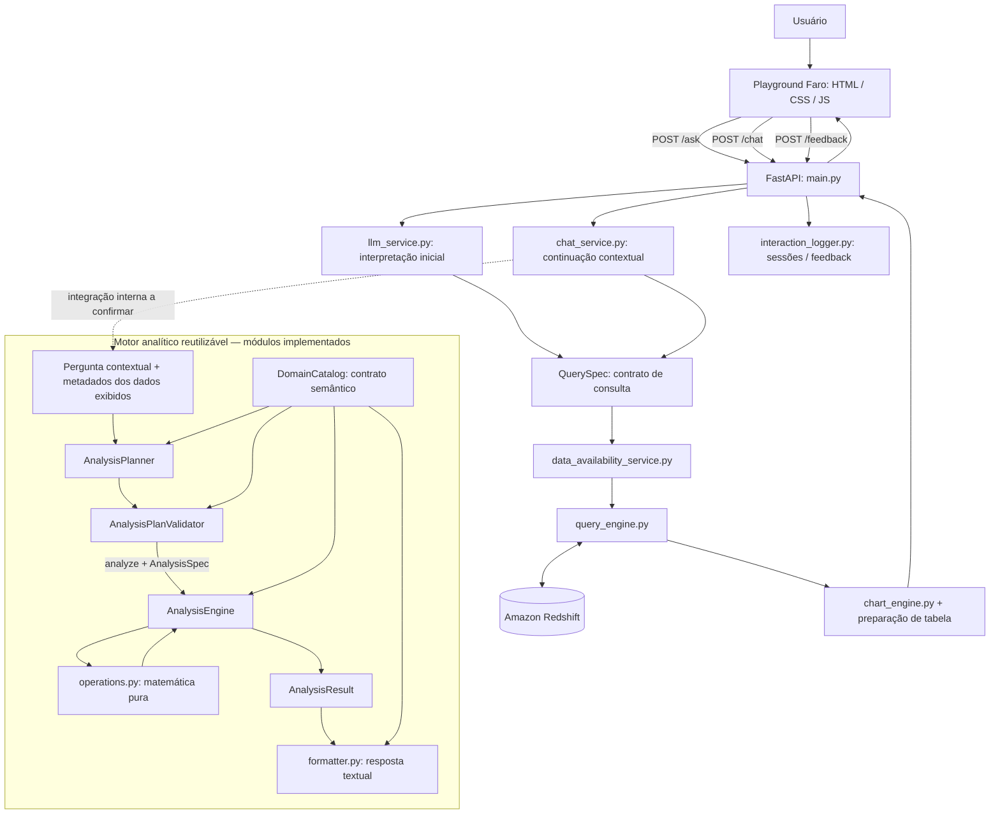
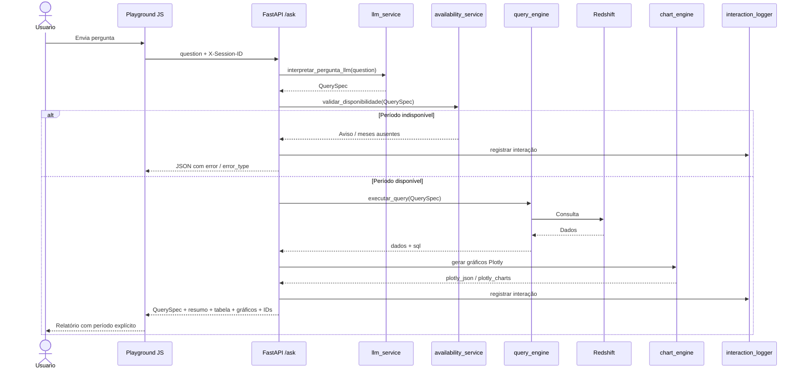
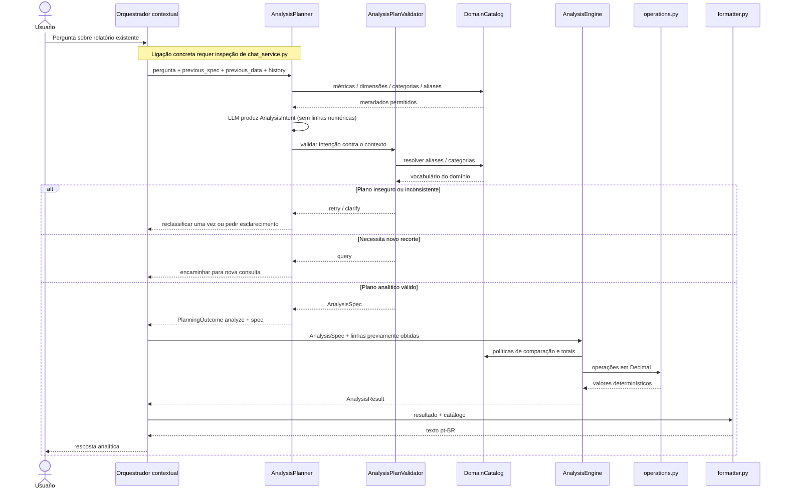

# Faro — Agente de Dados da SEFAZ

## 1. Visão geral

O **Faro** é uma aplicação que permite consultar e explorar dados de arrecadação da SEFAZ em linguagem natural. O usuário faz uma pergunta, o sistema interpreta sua intenção como uma especificação estruturada, consulta dados no **Amazon Redshift** e apresenta o resultado em tabelas, gráficos **Plotly** e resumos. Depois, o usuário pode fazer perguntas de continuação sobre o resultado anterior.

**Princípio arquitetural:** a interpretação em linguagem natural pode usar LLMs, mas o acesso e o processamento dos dados passam por contratos e funções do sistema. A LLM **não deve** executar SQL livre nem ser responsável pelos cálculos fiscais determinísticos. Na **análise sobre resultados já exibidos**, essa separação é concretizada nos módulos `analysis/`: a LLM escolhe uma intenção estruturada, o validador verifica sua fundamentação, o `AnalysisEngine` calcula e o formatador apenas apresenta o resultado. A execução de consultas novas continua sendo responsabilidade de `QuerySpec`/`query_engine.py`; a conexão exata desses caminhos com `chat_service.py` deve ser conferida nesse arquivo.


## 2. Arquitetura em alto nível

O Faro distingue **consultar dados** (buscar um recorte no Redshift) de **analisar um resultado existente** (operar sobre a tabela já retornada). A API expõe os fluxos `/ask` e `/chat`; a execução da análise reutilizável está implementada em um pacote independente.



**Leitura do diagrama:** setas contínuas fora do subgrafo representam chamadas/rotas observadas no `main.py`; o subgrafo representa dependências verificadas diretamente nos sete arquivos do pacote analítico fornecidos. A seta pontilhada **não** afirma uma ligação inspecionada com `chat_service.py`, pois esse módulo não foi fornecido. `query`/`defer`/`clarify` são possíveis saídas do planejamento; somente planos de ação `analyze` são destinados ao motor matemático.

## 3. Organização da solução

### 3.1. Estrutura principal

```text
MCP-SEFAZ-ARRECADACAO/
├── main.py                         # API FastAPI, endpoints e composição de respostas
├── schemas.py                      # Contratos da consulta, entre eles QuerySpec
├── llm_service.py                  # Interpretação inicial (referenciado pelo main.py)
├── ask_service.py                  # Resumos (referenciado pelo main.py)
├── chat_service.py                 # Roteamento das continuações (referenciado)
├── query_engine.py                 # Consulta ao Redshift (referenciado)
├── chart_engine.py                 # Construção dos gráficos Plotly (referenciado)
├── metadata_service.py             # Metadados (referenciado)
├── data_availability_service.py    # Disponibilidade do período (referenciado)
├── interaction_logger.py           # Sessões e avaliações (referenciado)
├── analysis/                       # Motor analítico separado (pacote inferido dos imports relativos)
│   ├── __init__.py                 # Estrutura indicativa: arquivo não inspecionado
│   ├── schemas.py                  # AnalysisSpec / AnalysisResult / operações / status
│   ├── planner.py                  # AnalysisPlanner / AnalysisIntent / PlanningOutcome
│   ├── validator.py                # AnalysisPlanValidator / ValidationDecision
│   ├── engine.py                   # AnalysisEngine (determinístico)
│   ├── operations.py               # Funções matemáticas puras (Decimal)
│   ├── formatter.py                # Resposta textual sem recálculo
│   └── domain.py                   # DomainCatalog / MetricDefinition
├── domains/                        # Registro do catálogo de domínio (importado por analysis.domain)
│   └── ...                         # Implementação fiscal concreta não anexada
├── templates/
│   └── playground.html             # Estrutura de interface
└── static/
    ├── css/playground.css          # Identidade visual e responsividade
    ├── js/playground.js            # Estado, interações, tabelas e Plotly
    └── images/faro.jpeg            # Avatar original
```

A árvore combina **arquivos confirmados**, **módulos referenciados** e **diretórios inferidos dos imports relativos**. O nome físico da pasta `analysis/` é indicado pelo pacote do projeto; a árvore não substitui uma listagem real do repositório. O arquivo `analysis/schemas.py` é **distinto** do `schemas.py` da raiz: o primeiro descreve operações matemáticas sobre resultados; o segundo descreve consultas por `QuerySpec`.

### 3.2. Separação de responsabilidades

| Camada | Componentes | Responsabilidade e limite |
|---|---|---|
| Apresentação | `templates/`, `static/` | Formulário, tabela, gráficos, avatar, período, histórico e feedback; sem cálculos de negócio |
| API/orquestração | `main.py` | Endpoints FastAPI, disponibilidade, composição do JSON e registro de eventos |
| Interpretação de consulta | `llm_service.py`, `schemas.py` (raiz) | Produzir/validar um `QuerySpec` para acessar novos dados |
| Roteamento contextual | `chat_service.py` | Distinguir resposta sobre dados atuais, nova consulta e outros encaminhamentos; implementação interna não anexada |
| Planejamento analítico | `analysis/planner.py` | LLM **classifica** intenção em dados já exibidos, sem receber valores numéricos das linhas |
| Validação analítica | `analysis/validator.py` | Confere escopo, métricas, categorias, referências do histórico; esclarece ambiguidades |
| Contratos analíticos | `analysis/schemas.py` | `AnalysisIntent` (em planner), `AnalysisSpec`, `AnalysisResult` e códigos de status |
| Operações e engine | `analysis/engine.py`, `analysis/operations.py` | Cálculos com `Decimal`, sem dependência da LLM nem SQL |
| Catálogo de domínio | `analysis/domain.py` + implementação em `domains/` | Vocabulário, métricas, dimensões, unidades, aliases, formatos de comparação e totais |
| Formatação analítica | `analysis/formatter.py` | Texto em português com valores **já calculados**, sem recalcular |
| Disponibilidade e dados | `data_availability_service.py`, `query_engine.py` | Validar o período, construir e executar consulta controlada no Redshift |
| Visualização | `chart_engine.py`, frontend | Figuras Plotly e tabelas, incluindo relatório ICMS/FECOP |
| Observabilidade | `interaction_logger.py` | Sessão, rastreabilidade, feedback e duração |

## 4. Fluxos de execução

### 4.1. Pergunta inicial — `POST /ask`



Etapas principais:

1. O JavaScript captura a pergunta e faz `POST /ask` com o cabeçalho opcional `X-Session-ID`.
2. `interpretar_pergunta_llm()` retorna uma especificação estruturada (`QuerySpec`). **Diferentemente da descrição simplificada antiga, o fluxo atual efetivamente chama a interpretação por LLM.**
3. `validar_disponibilidade()` verifica se o período pode ser consultado. Um erro nessa verificação ou a ausência de dados interrompe o processamento.
4. `executar_query()` fornece os dados e o SQL gerado.
5. `preparar_dados_tabela()` prepara linhas adicionais de **Total geral** somente para os agrupamentos por decêndio definidos na implementação.
6. `preparar_graficos()` converte os resultados para Plotly.
7. `resumo_relatorio()` ou `gerar_summary()` acrescenta o texto descritivo.
8. `_finalizar_interacao()` inclui IDs, registra a execução e devolve o JSON ao navegador.

**Tratamento de erros:** o endpoint `/ask` inclui falhas no próprio JSON com campos como `error` e `error_type`. Nem toda falha é exposta como status HTTP diferente de 200; clientes devem inspecionar também o corpo da resposta.

### 4.2. Pergunta de continuação — `POST /chat`

Ao contrário da consulta inicial, a continuação carrega contexto e pode resultar em **texto** ou **novo relatório**.

O navegador envia:

- `question`: nova pergunta;
- `previous_spec`: última consulta estruturada;
- `previous_data`: até 101 registros de dados brutos da última consulta;
- `history`: até 8 pares recentes de perguntas/respostas;
- cabeçalhos `X-Session-ID` e `X-Parent-Interaction-ID`.

A função `decidir_continuacao()` devolve uma decisão consumida por `main.py`. A API expõe ações `answer`, `query` e `error`, enquanto o planejamento analítico interno diferencia também `analyze`, `query`, `defer`, `clarify` e `invalid` (esses dois conjuntos **não são o mesmo contrato**):

| `action` | Significado | Comportamento da interface |
|---|---|---|
| `answer` | A pergunta pode ser respondida sobre o contexto disponível | Acrescenta mensagem do Faro sem substituir tabela/gráfico |
| `query` | É preciso executar nova consulta | Verifica disponibilidade, executa consulta e atualiza tabela/gráfico |
| `error` | Não foi possível atender à continuação | Exibe erro no chat |

O `main.py` identifica registros de resposta com origem **determinística** ou **LLM** quando a ação é `answer`, e classifica a nova consulta como `llm_query`. O contrato do motor analítico agora está documentado na seção 7, mas **a chamada exata ao `AnalysisPlanner` dentro do `chat_service.py` ainda não foi inspecionada**: não se deve assumir que todo `answer` é produzido pelo novo motor.

**Estado conversacional:** na implementação atual, `conversaAtual` e `historicoChat` residem no **JavaScript do navegador**. Eles são enviados nas solicitações posteriores. Não há evidência, nesses arquivos, de um armazenamento persistente do histórico para recuperação automática entre reinicializações do navegador. O registro de interações no servidor é uma responsabilidade distinta.

### 4.3. Avaliação das respostas — `POST /feedback`

O Playground oferece votação positiva/negativa por interação:

```json
{
  "session_id": "<identificador-da-sessao>",
  "interaction_id": "<identificador-da-interacao>",
  "vote": "positive"
}
```

O servidor verifica o par sessão/interação e registra o voto por `registrar_feedback()`. Uma interação não localizada produz **404**. O frontend apresenta o estado do voto escolhido e uma mensagem de confirmação ou erro.

## 5. Contratos e endpoints da API

| Método | Rota | Objetivo |
|---|---|---|
| `GET` | `/` | Verificação simples de funcionamento (`API funcionando`) |
| `GET` | `/playground` | Servir a interface HTML do Faro |
| `GET` | `/static/...` | Servir CSS, JavaScript e avatar |
| `GET` | `/metadata` | Expor metadados disponíveis para a aplicação |
| `POST` | `/ask` | Processar pergunta inicial em linguagem natural |
| `POST` | `/chat` | Processar continuação contextual |
| `POST` | `/feedback` | Registrar utilidade da resposta |
| `POST` | `/grafico` | Gerar dados de tabela e gráfico a partir de um `QuerySpec` |
| `POST` | `/grafico-html` | Renderizar o gráfico ou relatório em HTML Plotly |

O FastAPI também disponibiliza a documentação OpenAPI, normalmente em `/docs`, com a configuração padrão observada.

### 5.1. `QuerySpec`: contrato central

O `QuerySpec` é a representação estruturada entre a intenção interpretada e a consulta efetiva. Conforme os campos utilizados pela aplicação e a evolução já discutida no projeto, ele pode incluir:

- métricas e agrupamentos (`metric`, `group_by`);
- período (`start_date`, `end_date`) e, quando aplicável, períodos de comparação;
- filtros fiscais (como receita, subgrupo, segmento);
- opções analíticas/de apresentação (`analysis_type`, `chart_type`, `report_type`).

Esta é uma descrição **conceitual**, não o esquema Pydantic completo. As enumerações, campos obrigatórios, defaults e validações exatas devem ser conferidos em `schemas.py`.

### 5.2. Estrutura da resposta

Em respostas bem-sucedidas de `/ask`, os principais campos observados são:

```json
{
  "question": "Mostre a arrecadação de ICMS ...",
  "query_interpretada": { "...": "QuerySpec serializado" },
  "summary": "Resumo textual da análise",
  "aviso_disponibilidade": null,
  "sql": "Consulta SQL utilizada",
  "title": "Título do resultado",
  "chart_type": "bar",
  "dados_brutos": [],
  "dados_tabela": [],
  "plotly_json": { "data": [], "layout": {} },
  "plotly_charts": null,
  "session_id": "<id>",
  "interaction_id": "<id>"
}
```

**Exemplo ilustrativo de estrutura**, não resposta capturada da API. Em relatórios `icms_fecop`, `plotly_charts` contém uma lista de figuras, em vez de `null`.

**Distinção importante:** `dados_brutos` é o resultado da consulta utilizado nos gráficos; `dados_tabela` pode conter linhas adicionais de totalização, construídas no servidor sem alterar os dados de origem dos gráficos.

## 6. Camada de apresentação — Faro

A interface deixou de estar embutida em uma string HTML no `main.py`. A rota `/playground` agora lê `templates/playground.html`; o FastAPI publica `/static` para servir CSS, JavaScript e imagens.

### 6.1. Componentes de frontend

- **`playground.html`** define formulário inicial, exemplos de consultas, áreas de interpretação e SQL, resumo, tabela, gráficos, feedback e conversa contextual.
- **`playground.css`** concentra a identidade visual, tipografia, cores, responsividade, tabelas, grade de gráficos e estilo do avatar.
- **`playground.js`** controla eventos, chamadas `fetch()`, estado da conversa, formatação brasileira, montagem das tabelas, criação de feedback e renderização Plotly.
- **`faro.jpeg`** é a imagem original fornecida para o agente, exibida na abertura e em avatar de 38 × 38 pixels nas mensagens do assistente.

A tela de boas-vindas do Faro é ocultada após a primeira consulta bem-sucedida. O formulário inicial permanece disponível para novas perguntas.

### 6.2. Recorte temporal nos resultados

O período é **derivado do `query_interpretada` (`QuerySpec`) pelo JavaScript**, e não inferido do texto livre da pergunta. Com isso:

1. A seção **Tabela** exibe o período correspondente.
2. A seção **Gráficos** também exibe o período.
3. O título de cada figura Plotly incorpora uma descrição do período.
4. Perguntas que geram nova consulta atualizam a referência temporal.
5. Comparações exibem os dois períodos, quando seus metadados estão disponíveis.

Exemplos de apresentação:

- `Período: dezembro de 2025`
- `Comparação: setembro de 2025 × setembro de 2026`
- Intervalos incompletos, quando identificáveis, usam as datas de início/fim.

Esta mudança é de **apresentação**; não modifica o SQL, as regras fiscais nem os valores retornados do Redshift.

### 6.3. Gráficos e tabelas

A API retorna figuras Plotly serializadas. O navegador pode desenhar uma figura única (`plotly_json`) ou múltiplas (`plotly_charts`), usando uma grade responsiva. O frontend aplica rótulos e formatação `pt-BR` às colunas numéricas.

Para o relatório de composição **ICMS/FECOP**, o texto explicativo do servidor estabelece:

- **A:** ICMS bruto;
- **B:** FECOP;
- **C:** ICMS sem FECOP, calculado como `A − B`;
- **D:** ICMS líquido do Tesouro, calculado como `60% de C`.

A verificação dos cálculos em sua origem requer inspeção de `query_engine.py` e/ou das consultas utilizadas; o README não considera a simples presença dessas fórmulas no resumo como teste de consistência financeira.

## 7. Motor analítico: etapas, contratos e separação de responsabilidades

Esta é a mudança arquitetural central do projeto. A primeira versão tratava o resultado de uma consulta como uma resposta terminal. A evolução introduziu um **motor para perguntas analíticas sobre resultados já exibidos**, preservando a possibilidade de executar nova consulta quando há mudança de recorte. Os módulos `engine.py`, `operations.py`, `schemas.py`, `planner.py`, `validator.py`, `formatter.py` e `domain.py` desta seção foram fornecidos e inspecionados.

### 7.1. Por que um segundo caminho analítico?

Há duas operações de natureza diferente:

| Solicitação | Exemplo | O que precisa acontecer |
|---|---|---|
| **Nova consulta** | “Mostre ICMS por segmento em maio de 2026” | Interpretar `QuerySpec`, verificar disponibilidade, consultar Redshift, renderizar relatório |
| **Análise do resultado** | “Qual segmento liderou nessa tabela?” | Examinar somente os dados já exibidos; planejar uma operação admissível; executar matemática determinística; responder sem outra consulta |
| **Mudança de escopo** | “Agora compare com abril” | Retornar à rota de consulta, pois a tabela atual não contém necessariamente abril |
| **Ambiguidade real** | “Qual foi a variação percentual?” sem categoria identificável | Solicitar esclarecimento; não inventar categoria nem passar o cálculo para a LLM |

Essa separação evita delegar ao modelo linguístico a aritmética e a decisão de quais números são verdadeiros. O planejador pode utilizar IA para interpretar *o pedido*, mas o motor calcula sobre dados definidos pelo sistema.

### 7.2. Evolução implementada em três etapas

| Etapa | Implementação | Decisão arquitetural | Situação observada |
|---|---|---|---|
| **1 — Motor determinístico** | `AnalysisSpec`, `AnalysisResult`, `AnalysisEngine`, `operations.py` e `formatter.py` | Contrato estável e operações numéricas isoladas da LLM e da camada de dados | Módulos fornecidos; histórico do projeto registrou 55/55 testes e 98% de cobertura naquele estágio, **não reexecutados aqui** |
| **2 — Planejamento e validação** | `AnalysisPlanner`, `AnalysisIntent`, `AnalysisPlanValidator`, `PlanningOutcome` | LLM interpreta intenção; validador confirma escopo e referências; apenas engine calcula | Código fornecido; histórico reportou correções de falsos negativos e testes de perguntas repetidas e follow-ups |
| **3 — Desacoplamento de domínio** | `DomainCatalog`, `MetricDefinition`, `resolve_catalog()` e extração de primitivas reutilizáveis | Motor passa a receber vocabulário e políticas do domínio em vez de conter regras fiscais fixas | Código fornecido; histórico reportou bateria 1 aprovada e questões nas baterias 2/3, cuja conclusão não foi comprovada neste material |

O objetivo **não foi refazer os cálculos** ao introduzir o catálogo, mas preservar seus contratos e comportamento enquanto o conhecimento do domínio fiscal sai do núcleo analítico.

### 7.3. Sequência interna de uma análise contextual



O diagrama apresenta a **separação de responsabilidades** suportada pelos módulos. Os detalhes do encaixe do planner e formatador no roteamento real de `chat_service.py` precisam ser confirmados no respectivo código; não são garantidos apenas por esse desenho.

### 7.4. Contratos: `QuerySpec` não é `AnalysisSpec`

- `QuerySpec` (raiz, `schemas.py`) descreve **qual consulta executar**: métricas, dimensões, filtros, agrupamentos, períodos e opções de relatório. É consumido pelo caminho que acessa o Redshift.
- `AnalysisSpec` (`analysis/schemas.py`) descreve **qual operação executar sobre os dados presentes**: `operation`, `metric`, `category`, `explicit_category`, `group_by`, `analysis_type`, `report_type`, rótulos dos períodos e `others_named`. Não importa nem depende de `QuerySpec`.
- `AnalysisIntent` (`analysis/planner.py`) é a saída estruturada da LLM: `action`, `operation`, `metric`, `category`, `category_source`. A ação admite apenas `analyze`, `query` e `defer`; a categoria pode vir de `current`, `previous` ou `none`.
- `PlanningOutcome` representa a saída já processada pelo planejador: `analyze`, `query`, `defer`, `invalid` ou `clarify`, com `spec`, `reason` e `question` opcionais.
- `AnalysisResult` reúne `spec`, `status`, `metric_name`, `category`, `counterpart`, `selected_period` e `values` em `Decimal | None`. O formato de retorno permite distinguir resultados válidos de pedidos mal especificados ou dados insuficientes.

**Exemplo ilustrativo de plano analítico** (não é uma consulta SQL nem uma captura real da LLM):

```json
{
  "operation": "maximo",
  "metric": "valor_arrecadado",
  "category": null,
  "explicit_category": null,
  "group_by": "segmento",
  "analysis_type": "single_period",
  "report_type": "standard",
  "period_1_label": null,
  "period_2_label": null,
  "others_named": false
}
```

O valor de `analysis_type` é ilustrativo: o contrato `AnalysisSpec` o representa como `str`; o valor exato da análise simples deve seguir o `QuerySpec` existente. O exemplo mostra apenas a forma da mensagem enviada ao motor.

### 7.5. `AnalysisPlanner`: a LLM interpreta; não calcula

O método `AnalysisPlanner.plan(req)`:

1. Obtém o contexto anterior (`previous_spec`) e remove totais de `previous_data` usando `DomainCatalog.without_totals()`.
2. Descobre indicadores **efetivamente presentes** (`metricas_disponiveis`) e categorias existentes nas linhas.
3. Monta um payload com pergunta, períodos, agrupamento, métricas e categorias disponíveis, indicador de truncamento e **apenas a última troca conversacional**.
4. Mascara valores monetários e percentuais da última resposta, preservando os referentes textuais (`_safe_last_turn`). **Não envia as linhas numéricas** à LLM de planejamento.
5. Solicita a saída estruturada `AnalysisIntent` por `responses.parse(..., text_format=AnalysisIntent, store=False)`. O modelo é configurável via `ANALYSIS_PLANNER_MODEL` ou `OPENAI_MODEL`, com fallback definido no código.
6. Submete a intenção ao `AnalysisPlanValidator`; se necessário, permite **uma única nova classificação**, totalizando no máximo duas tentativas.
7. Retorna um `PlanningOutcome` com o plano validado, indicação de nova consulta, delegação ou esclarecimento. Se a resposta estruturada falhar, tenta recuperação estritamente limitada a intenções inequívocas.

`AnalysisIntent` usa Pydantic com `extra="forbid"` e valida combinações coerentes: intenções não analíticas não podem conter operação/métrica/categoria; uma intenção `analyze` exige operação. O prompt orienta explicitamente a **não produzir SQL, cálculos ou explicações ao usuário**.

O planejador não recebe as linhas numéricas; isso reduz a possibilidade de produzir resultados quantitativos sem passar pelo motor, mas não é uma prova isolada de isolamento em todos os caminhos da aplicação.

### 7.6. `AnalysisPlanValidator`: validação semântica antes da execução

A camada determinística entre a classificação da LLM e o motor analítico verifica, entre outros casos:

- **Escopo dos dados:** `query` precisa de evidência de novo período, filtro, agrupamento ou gráfico; caso contrário, ocorre reclassificação e, persistindo incerteza, esclarecimento.
- **Categoria fundamentada:** nomes devem corresponder a categorias retornadas. Referências de `previous` são verificadas **somente na última interação**, não em todo o histórico.
- **Prioridade do pedido atual:** categoria mencionada explicitamente agora prevalece sobre a última resposta e sobre sugestões da LLM.
- **Rankings globais:** “qual segmento mais arrecadou?” não deve assumir como alvo o vencedor de uma resposta anterior; categoria não sustentada pode ser descartada para rankings globais.
- **Operações e períodos:** crescimento requer dois períodos; amplitude e comparação com “outros” são limitadas ao contexto de período único; para variação de uma categoria é necessário identificar a categoria.
- **Ambiguidades:** pergunta sobre múltiplas categorias ou sobre a referência indefinida leva a `clarify`, não a seleção arbitrária.
- **Correções conservadoras:** uma formulação inequívoca de diferença entre maior e menor pode ser convertida em `amplitude`. `recover_unambiguous()` contempla apenas amplitude global, valor de categoria explicitamente citada e continuação percentual com um único referente comprovável.

O validador **não altera períodos, valores ou métricas da consulta** e **não executa operações numéricas**. Também não transforma automaticamente `query` em `analyze` quando há evidência de mudança de recorte. A sua saída é `ValidationDecision` (`analyze`, `query`, `defer`, `clarify` ou `retry`).

Esses controles foram adicionados para combater falsos negativos e falsos positivos de interpretação durante as baterias de follow-ups, especialmente em perguntas repetidas sob contextos diferentes.

### 7.7. `AnalysisEngine` e `operations.py`: matemática determinística

O `AnalysisEngine.execute(spec, linhas)` recebe um `AnalysisSpec` e uma lista de registros já exibidos. Ele **não depende** de cliente Redshift, LLM, `ChatRequest` nem `QuerySpec`. Os valores aceitos são convertidos para `Decimal(str(valor))`, rejeitando booleanos e campos não numéricos.

`operations.py` reúne primitivas matemáticas puras:

| Função | Papel |
|---|---|
| `rank_values()` | Identificar valor extremo com critério de desempate definido |
| `amplitude_values()` | Maior menos menor dentro de um conjunto de categorias |
| `sum_others()` | Comparar categoria nomeada com a soma das demais |
| `period_changes()` | Diferenças absolutas e variações percentuais entre dois períodos |
| `extreme_period()` | Maior/menor período para uma categoria |

O catálogo orienta como o engine identifica dimensão, linhas de totalização, campo de período e formato da comparação. O motor suporta tanto **comparação em colunas** (uma linha por categoria, colunas para período 1 e 2) quanto **comparação em linhas** (categoria + campo de período + métrica). Em ambos os casos, **pares incompletos ou duplicados são rejeitados**: valor ausente não é substituído por zero.

Operações de negócio disponíveis no contrato (`AnalysisOperation`):

```text
valor · maximo · minimo · amplitude · outros
variacao · diferenca · variacao_percentual
crescimento_max · crescimento_min
crescimento_max_percentual · crescimento_min_percentual
```

Regras de integridade relevantes:

- No protocolo atual, `len(linhas) >= 101` gera `too_many_rows` e **bloqueia cálculo sobre possível resultado truncado**. Esse limite é uma salvaguarda do contrato vigente, não uma prova de que cada conjunto de até 100 linhas representa o universo completo.
- Totais artificiais do relatório são excluídos antes de calcular extremos ou somas, via `without_totals()`.
- Variação absoluta é `período_2 − período_1`; percentual tem o **primeiro período como referência**. Referência zero retorna estado/valor indefinido, não uma divisão inventada.
- Operações que exigem categoria específica retornam estados explícitos quando ela não foi definida ou não consta da tabela.
- Empates têm comportamento previsível conforme as primitivas (`rank_values` mantém a primeira ocorrência; `extreme_period` escolhe segundo período no empate de máximo e primeiro no empate de mínimo).

**Importante:** `AnalysisEngine` não é `query_engine.py`. O primeiro calcula **a partir de resultados existentes**; o segundo consulta a **fonte de dados**.

### 7.8. `AnalysisResult` e `formatter.py`: apresentação sem recálculo

O motor retorna um `AnalysisResult` estruturado. Seu `status` pode ser, por exemplo, `ok`, `too_many_rows`, `invalid_data`, `metric_required`, `category_required`, `category_not_found`, `comparison_period_required`, `percent_reference_zero` ou `unsupported`.

`format_analysis_result(result, catalog)` converte esses estados e valores em mensagens em português. O código utiliza:

- rótulos de métricas e categorias vindos do `DomainCatalog`;
- unidades `currency`, `count`, `number` e `percent` para apresentação;
- formatação `pt-BR` e símbolo monetário configurado no catálogo;
- indicação de períodos comparados;
- mensagens explícitas para dados incompletos, referência percentual zero e categoria ausente.

O **formatador não executa um segundo cálculo**: recebe os valores já produzidos pelo engine e apenas aplica formato textual.

### 7.9. `DomainCatalog`: retirar regras fiscais do núcleo analítico

`analysis/domain.py` define `MetricDefinition` (`label`, `aliases`, `unit`) e `DomainCatalog`, que contém:

| Propriedade | Finalidade |
|---|---|
| `id`, `metrics`, `dimensions` | Identificar o domínio e o universo de indicadores/agrupamentos |
| `metric_priority`, `derived_numeric_fields` | Precedência de reconhecimento e exclusão de campos derivados |
| `category_aliases`, `dimension_aliases` | Vocabulário de categorias e dimensões usado em perguntas |
| `report_metric_aliases` | Remapeamento de indicador conforme o tipo de relatório |
| `long_comparison_reports`, `period_field` | Identificar comparações representadas em linhas |
| `total_row_field`, `total_row_label` | Detectar e excluir linhas artificiais de totalização |
| `currency_symbol`, `metric_prompt`, `metric_question` | Semântica e apresentação específicas do domínio |
| `default_context_metric_reports` | Determinar quando é seguro reutilizar a métrica contextual |

O catálogo fornece funções como `without_totals()`, `mentions_category()`, `mentioned_metrics()`, `context_metric()`, `remap_metric()`, `dimension_from_phrase()` e `planner_context()`. O objeto é `dataclass(frozen=True)` e usa `MappingProxyType` para mapas principais, reduzindo o risco de modificação acidental entre requisições.

O mecanismo `resolve_catalog(catalog)` utiliza **o catálogo explícito**, quando fornecido; caso contrário carrega `default_catalog()` do módulo `domains`. Esse é o ponto de entrada para um domínio fiscal concreto. O conteúdo do catálogo fiscal (`domains/`) **não foi anexado**, então não afirmamos aqui seus aliases, métricas concretas ou regras individuais.

Exemplo **conceitual** de utilização do contrato em outro domínio (não representa implementação já instalada):

```python
from analysis.domain import DomainCatalog, MetricDefinition
from analysis.engine import AnalysisEngine

catalogo = DomainCatalog(
    id="atendimento",
    metrics={"quantidade": MetricDefinition(label="Atendimentos", unit="count")},
    dimensions=("unidade",),
    currency_symbol="R$",
)
engine = AnalysisEngine(catalog=catalogo)
# engine.execute(analysis_spec, linhas_da_consulta)
```

Novos domínios não exigem alterar `period_changes()` ou `rank_values()`, mas **exigem um catálogo próprio, uma origem de dados e integração/testes**. Isso prepara o motor para reutilização com outros MCPs sem afirmar que esses conectores já existem.

### 7.10. Limites de segurança, decisões difíceis e não objetivos

1. **Sem SQL gerado pelo motor analítico.** O motor opera sobre linhas recebidas; consulta ao Redshift pertence ao fluxo `QuerySpec`/`query_engine.py`.
2. **Sem aritmética confiada à LLM.** O planner classifica intenções; operações estão nas funções Python com `Decimal`.
3. **Sem adivinhar ambiguidades.** Onde escopo, categoria ou referência temporal são indeterminados, a arquitetura privilegia esclarecimento.
4. **Sem transformar truncamento em total.** Nem `top_n` nem os 101 registros encaminhados à continuação podem ser interpretados automaticamente como universo completo.
5. **Sem vazamento de regras fiscais para o core.** O núcleo analítico depende do contrato `DomainCatalog`; valores concretos devem estar na implementação do domínio.
6. **Sem confundir intenção com resultado.** `AnalysisIntent` (proposta da LLM), `AnalysisSpec` (plano validado) e `AnalysisResult` (cálculo) são objetos diferentes.
7. **Sem alegar integração fim a fim não verificada.** Os módulos novos foram inspecionados; para atestar precisamente onde `chat_service.py` instancia `AnalysisPlanner`, executa `AnalysisEngine` e chama `format_analysis_result`, é necessário ler esse arquivo.

> **Nota sobre “MCP”:** o nome do repositório não demonstra, por si só, uma implementação do protocolo *Model Context Protocol*. Os arquivos aqui verificados mostram uma aplicação HTTP REST/FastAPI e um motor analítico desacoplado, projetado para reutilização em integrações futuras. Um servidor MCP, se houver, requer documentação separada de suas ferramentas e contratos.

## 8. Observabilidade, erros e segurança

### 8.1. Rastreabilidade

O `interaction_logger.py` é invocado pelos endpoints para:

- gerar/validar identificadores de sessão e de interação;
- registrar pergunta, resposta, tipo de interação e duração em milissegundos;
- relacionar follow-ups à interação anterior por `parent_interaction_id`;
- registrar a origem classificada da resposta quando fornecida;
- associar feedback positivo/negativo a uma interação;
- capturar `request.client.host`, quando disponível.

O destino físico dos logs, a política de retenção, os índices e o tratamento de dados pessoais não são determináveis sem o código do logger e a configuração de implantação.

### 8.2. Controles e recomendações

**Comportamentos visíveis:**

- `QuerySpec` é um modelo estruturado importado de `schemas.py`.
- A disponibilidade temporal é checada antes da consulta nos fluxos que executam dados.
- As falhas de disponibilidade e execução são traduzidas em mensagens de erro.
- A interface usa `textContent` para mensagens e escape HTML para valores de células, mitigando injeção de marcação nesses pontos.

**Pontos a confirmar antes de produção institucional:**

- autenticação e autorização de usuários;
- autorização de acesso a dados por perfil, se aplicável;
- regras e limites de consulta no `query_engine.py`;
- segredos de Redshift/LLM via configuração segura (não versionar `.env`);
- política de armazenamento e retenção de perguntas, SQL e IPs;
- limites para volume de dados retornado ao navegador;
- comportamento atrás de proxy reverso (IP de origem e cabeçalhos de encaminhamento);
- dependência de CDN externa para Plotly e suas implicações em redes restritas.

**Não presumir:** o `main.py` analisado não exibe middleware de autenticação nem um mecanismo de controle de permissão. Não há base suficiente para afirmar que a API inteira já está protegida para uso público.

## 9. Como executar em desenvolvimento

Dentro da raiz do projeto, com o ambiente virtual configurado e as dependências instaladas:

```powershell
# Exemplo de ativação quando o .venv fica na pasta imediatamente superior
..\.venv\Scripts\Activate.ps1

# Subir o FastAPI com atualização automática
uvicorn main:app --reload
```

Endereços locais padrão:

- Playground: `http://127.0.0.1:8000/playground`
- Documentação interativa: `http://127.0.0.1:8000/docs`
- Verificação da API: `http://127.0.0.1:8000/`
- Imagem do Faro: `http://127.0.0.1:8000/static/images/faro.jpeg`

É necessário que a configuração de acesso ao Redshift e de uso do modelo esteja correta para executar perguntas completas. Os nomes exatos das variáveis de ambiente não foram documentados aqui, pois os arquivos de configuração não foram fornecidos nesta revisão.

**O comando com `--reload` é destinado a desenvolvimento**, não a uma implantação de produção.

## 10. Estratégia de testes

### 10.1. Testes de regressão da interface

- [ ] A página `/playground` carrega, incluindo CSS, JavaScript e imagem do Faro.
- [ ] Uma pergunta inicial executa `/ask` e apresenta QuerySpec, SQL, resumo, tabela e gráficos.
- [ ] Consultas com gráfico único e relatório com múltiplos gráficos funcionam.
- [ ] O período aparece junto à tabela e em cada gráfico, inclusive em comparações.
- [ ] A primeira consulta oculta a saudação inicial, preservando a entrada para nova consulta.
- [ ] O avatar do Faro aparece discretamente nas mensagens do assistente.
- [ ] Um follow-up de resposta textual mantém o relatório anterior.
- [ ] Um follow-up com `action=query` atualiza gráfico, tabela e período.
- [ ] O histórico é transmitido em continuações e truncado conforme os limites da interface.
- [ ] O feedback positivo/negativo é registrado e seu estado aparece corretamente.
- [ ] Erros de LLM, indisponibilidade e falhas de execução apresentam mensagens compreensíveis.

### 10.2. Testes do domínio e do motor analítico

A regressão analítica deve cobrir **isoladamente** o parser/planejador, o validador, as funções matemáticas e o catálogo, além dos testes de integração com `/chat`. Os testes unitários não substituem a verificação de consultas reais.

| Componente | Casos de referência |
|---|---|
| `operations.py` | Valores negativos/zero, rankings, empates, amplitude e variação percentual com base zero |
| `engine.py` | Comparação longa e larga, linhas duplicadas, pares ausentes, totais artificiais, `>= 101` linhas |
| `planner.py` | Perguntas equivalentes, classificação `analyze`/`query`/`defer`, tentativa de recálculo pela LLM, duas tentativas máximas |
| `validator.py` | Mudança real de recorte, categorias inexistentes, múltiplos referentes, elipses de follow-up, rankings globais |
| `domain.py` | Mudança de catálogos, aliases de indicadores/dimensões, unidade e separação entre domínios |
| `formatter.py` | Correspondência de `AnalysisResult` com mensagens textuais, sem matemática adicional |


- [ ] Comparar totais calculados com consultas de referência no Redshift.
- [ ] Validar ICMS/FECOP (`C = A − B`, `D = 0,6 × C`) e arredondamentos.
- [ ] Validar agrupamentos por decêndio, total geral e comparações entre períodos.
- [ ] Repetir perguntas e follow-ups em contextos diferentes para verificar o plano correto.
- [ ] Confirmar que operações determinísticas não são executadas pela LLM.
- [ ] Retomar as baterias 2 e 3 da Etapa 3 (`DomainCatalog`), que apresentaram problemas no histórico do projeto; repetir a bateria 1 como regressão.

As listas acima são **critérios recomendados**, não um atestado de que a bateria foi executada nesta revisão.

## 11. Histórico resumido da evolução

| Momento | Mudança |
|---|---|
| Arquitetura inicial | Pergunta → interpretação baseada em regras → `QuerySpec` → `query_engine.py` → Redshift → Plotly → resposta |
| Interpretação atual | Uso de `llm_service.py` para interpretar perguntas iniciais |
| Conversação | Inclusão de `/chat` e uso de contexto, histórico, dados anteriores e ações `answer`/`query` |
| Observabilidade | Inclusão de sessão, ID de interação, feedback e registro de execução |
| Relatórios especializados | Suporte a composição ICMS/FECOP, totais por decêndio e múltiplos gráficos |
| Faro — Etapa 1 | Identidade visual com avatar original na abertura e no chat |
| Faro — Etapa 2 | Separação de HTML, CSS e JavaScript do arquivo `main.py` |
| Evolução da apresentação | Inclusão do recorte temporal explícito na tabela e nos títulos dos gráficos |
| Motor analítico — Etapa 1 | Criação de contratos `AnalysisSpec`/`AnalysisResult`, operações puras, `AnalysisEngine` e `formatter.py`; cálculos saem da LLM |
| Motor analítico — Etapa 2 | Inclusão de `AnalysisPlanner`, intenção estruturada, `AnalysisPlanValidator`, reclassificação e esclarecimento seguro; testes de follow-ups e falsos negativos |
| Motor analítico — Etapa 3 | `DomainCatalog`/`MetricDefinition` e extração da semântica fiscal; core reutilizável sem alteração proposital da matemática; baterias 2/3 ainda merecem revisão |

## 12. Próximos passos documentais e técnicos

1. Conferir `schemas.py` (da raiz), `query_engine.py`, `chat_service.py` e `llm_service.py` para completar os contratos de consulta e confirmar os pontos exatos de integração com o pacote `analysis/`.
2. Inspecionar a implementação do catálogo fiscal em `domains/` e finalizar as baterias 2/3 de regressão da Etapa 3.
3. Adicionar um catálogo de erros da API, com distinção entre erros HTTP e erros retornados no corpo JSON.
4. Formalizar configuração de ambiente (`.env.example`, dependências, credenciais e perfis de implantação), sem incluir segredos.
5. Consolidar testes automatizados e registrar evidências de regressão.
6. Definir autenticação, autorização, tratamento dos logs e política de acesso antes de exposição fora de ambiente controlado.

---

**Resumo:** o Faro reúne **FastAPI + HTML/CSS/JavaScript + Plotly + Redshift** no caminho de consulta e um **motor analítico determinístico desacoplado** (`AnalysisPlanner` → `AnalysisPlanValidator` → `AnalysisSpec` → `AnalysisEngine`/`operations.py` → `AnalysisResult` → `formatter.py`) parametrizado por `DomainCatalog`. Os sete módulos analíticos foram inspecionados; o fluxo exato de integração no roteador `chat_service.py`, a implementação fiscal em `domains/` e as baterias remanescentes devem ser verificados antes de considerar a evolução inteiramente validada.
