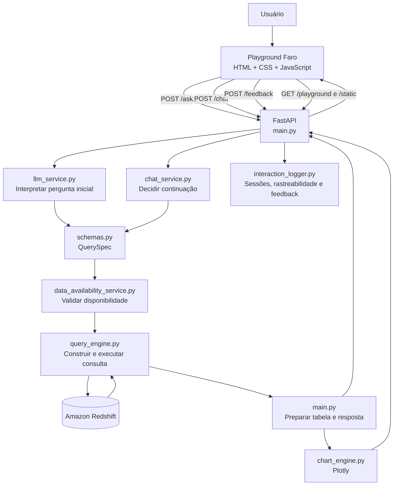
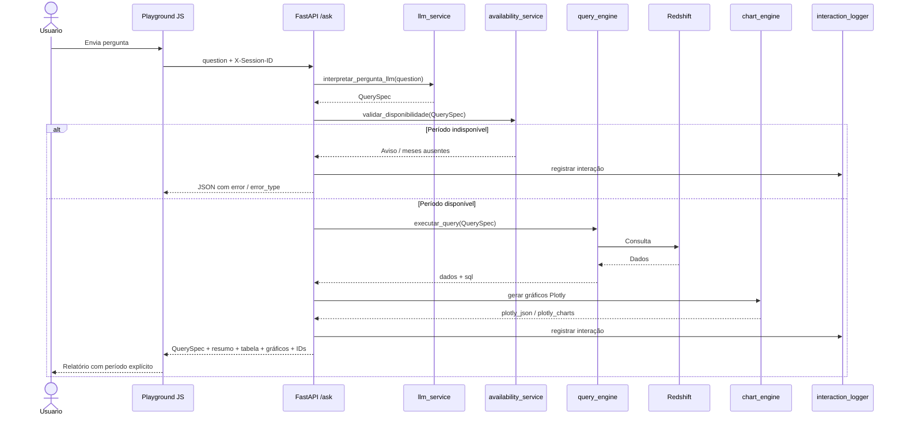
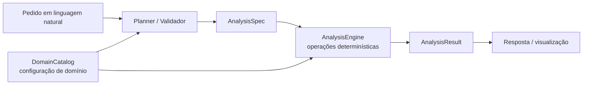

# Faro — Agente de Dados da SEFAZ

## 1. Visão geral

O **Faro** é uma aplicação que permite consultar e explorar dados de arrecadação da SEFAZ em linguagem natural. O usuário faz uma pergunta, o sistema interpreta sua intenção como uma especificação estruturada, consulta dados no **Amazon Redshift** e apresenta o resultado em tabelas, gráficos **Plotly** e resumos. Depois, o usuário pode fazer perguntas de continuação sobre o resultado anterior.

O projeto evoluiu de um fluxo linear — pergunta → interpretação → `QuerySpec` → SQL → gráfico — para uma solução com **API**, **validação de disponibilidade**, **conversação contextual**, **registro de interações e feedback** e **frontend separado do backend**.

**Princípio arquitetural:** a interpretação em linguagem natural pode usar LLMs, mas o acesso e o processamento dos dados passam por contratos e funções do sistema. A LLM **não deve** executar SQL livre nem ser responsável pelos cálculos fiscais determinísticos. Esse é o princípio adotado pelo projeto; a garantia concreta depende da implementação dos módulos de consulta e análise, que deve continuar sendo auditada.

### Escopo verificado e limites desta documentação

Esta versão do README foi produzida a partir de:

1. Documento anterior `Arquitetura.txt` (a descrição simplificada fornecida como referência histórica).
2. `main.py` da versão atualizada do Faro.
3. `templates/playground.html`, `static/css/playground.css`, `static/js/playground.js` e a imagem do Faro, presentes no pacote da evolução do frontend.
4. Histórico de desenvolvimento do projeto sobre a evolução `AnalysisEngine`/`AnalysisPlanner`/`AnalysisPlanValidator`/`DomainCatalog`.

**Importante:** os arquivos-fonte de `schemas.py`, `query_engine.py`, `llm_service.py`, `chat_service.py`, `analysis_engine.py` e demais módulos internos **não foram anexados nesta revisão**. Suas atribuições são documentadas a partir dos imports, chamadas e contratos visíveis no `main.py`, acrescidos do histórico do projeto. Por isso, detalhes internos e a integração efetiva do novo motor analítico não são apresentados como verificados.

## 2. Arquitetura em alto nível



O diagrama representa o **fluxo implementado e visível no `main.py`**. O planejamento analítico reutilizável, desenvolvido em etapas posteriores do projeto, é tratado na seção 7 porque sua conexão exata com os endpoints depende de verificação adicional nos módulos internos.

## 3. Organização da solução

### 3.1. Estrutura principal

```text
MCP-SEFAZ-ARRECADACAO/
├── main.py                        # Aplicação FastAPI, rotas e composição da resposta
├── schemas.py                     # Contratos de entrada e QuerySpec (referenciado no main.py)
├── llm_service.py                 # Interpretação da pergunta inicial (referenciado)
├── ask_service.py                 # Resumo textual (referenciado)
├── chat_service.py                # Interpretação das continuações (referenciado)
├── query_engine.py                # Execução das consultas (referenciado)
├── chart_engine.py                # Geração dos gráficos Plotly (referenciado)
├── metadata_service.py            # Metadados disponíveis (referenciado)
├── data_availability_service.py   # Validação de disponibilidade temporal (referenciado)
├── interaction_logger.py          # Sessões, interações e avaliações (referenciado)
├── templates/
│   └── playground.html            # Estrutura da tela do Faro
└── static/
    ├── css/
    │   └── playground.css         # Identidade visual e responsividade
    ├── js/
    │   └── playground.js          # Eventos, estado da UI, tabela e gráficos
    └── images/
        └── faro.jpeg              # Imagem original do avatar
```

A árvore acima descreve **arquivos vistos nos pacotes de frontend** e **módulos explicitamente importados por `main.py`**; não pretende ser uma listagem exaustiva do repositório. Componentes analíticos adicionais podem estar em outros diretórios.

### 3.2. Separação de responsabilidades

| Camada | Componentes | Responsabilidade |
|---|---|---|
| Apresentação | `templates/playground.html`, `static/css/playground.css`, `static/js/playground.js` | Capturar perguntas, exibir resultados, avatar, gráficos, tabelas e feedback |
| API/orquestração | `main.py`, FastAPI | Expor endpoints e coordenar as etapas de cada requisição |
| Interpretação de linguagem | `llm_service.py` | Converter perguntas iniciais em intenção/consulta estruturada |
| Continuação contextual | `chat_service.py` | Distinguir resposta textual de uma nova consulta a partir do contexto |
| Contratos | `schemas.py` | Representar e validar `QuerySpec` e modelos de entrada |
| Disponibilidade | `data_availability_service.py` | Verificar existência de dados para o período antes de consultar |
| Acesso a dados | `query_engine.py` | Gerar/executar consultas controladas e retornar dados e SQL |
| Visualização | `chart_engine.py` | Produzir objetos Plotly, incluindo relatórios com múltiplos gráficos |
| Apresentação dos resultados | Funções auxiliares em `main.py` e JavaScript | Adicionar totais da tabela, formatar valores e período de referência |
| Observabilidade | `interaction_logger.py` | Registrar interações, origem, duração, IDs de sessão e avaliações |

## 4. Fluxos de execução

### 4.1. Pergunta inicial — `POST /ask`



Etapas principais:

1. O JavaScript captura a pergunta e faz `POST /ask` com o cabeçalho opcional `X-Session-ID`.
2. `interpretar_pergunta_llm()` retorna uma especificação estruturada (`QuerySpec`). **Diferentemente da descrição simplificada antiga, o fluxo atual efetivamente chama a interpretação por LLM.**
3. `validar_disponibilidade()` verifica se o período pode ser consultado. Um erro nessa verificação ou a ausência de dados interrompe o processamento.
4. `executar_query()` fornece os dados e o SQL gerado.
5. `preparar_dados_tabela()` prepara linhas adicionais de **Total geral** somente para os agrupamentos por decêndio definidos na implementação.
6. `preparar_graficos()` converte os resultados para Plotly.
7. `resumo_relatorio()` ou `gerar_summary()` acrescenta o texto descritivo.
8. `_finalizar_interacao()` inclui IDs, registra a execução e devolve o JSON ao navegador.

**Tratamento de erros:** o endpoint `/ask` inclui falhas no próprio JSON com campos como `error` e `error_type`. Nem toda falha é exposta como status HTTP diferente de 200; clientes devem inspecionar também o corpo da resposta.

### 4.2. Pergunta de continuação — `POST /chat`

Ao contrário da consulta inicial, a continuação carrega contexto e pode resultar em **texto** ou **novo relatório**.

O navegador envia:

- `question`: nova pergunta;
- `previous_spec`: última consulta estruturada;
- `previous_data`: até 101 registros de dados brutos da última consulta;
- `history`: até 8 pares recentes de perguntas/respostas;
- cabeçalhos `X-Session-ID` e `X-Parent-Interaction-ID`.

A função `decidir_continuacao()` escolhe entre dois caminhos:

| `action` | Significado | Comportamento da interface |
|---|---|---|
| `answer` | A pergunta pode ser respondida sobre o contexto disponível | Acrescenta mensagem do Faro sem substituir tabela/gráfico |
| `query` | É preciso executar nova consulta | Verifica disponibilidade, executa consulta e atualiza tabela/gráfico |
| `error` | Não foi possível atender à continuação | Exibe erro no chat |

O `main.py` identifica registros de resposta com origem **determinística** ou **LLM** quando a ação é `answer`, e classifica a nova consulta como `llm_query`. A estratégia interna de decisão depende do `chat_service.py`, que não foi inspecionado nesta revisão.

**Estado conversacional:** na implementação atual, `conversaAtual` e `historicoChat` residem no **JavaScript do navegador**. Eles são enviados nas solicitações posteriores. Não há evidência, nesses arquivos, de um armazenamento persistente do histórico para recuperação automática entre reinicializações do navegador. O registro de interações no servidor é uma responsabilidade distinta.

### 4.3. Avaliação das respostas — `POST /feedback`

O Playground oferece votação positiva/negativa por interação:

```json
{
  "session_id": "<identificador-da-sessao>",
  "interaction_id": "<identificador-da-interacao>",
  "vote": "positive"
}
```

O servidor verifica o par sessão/interação e registra o voto por `registrar_feedback()`. Uma interação não localizada produz **404**. O frontend apresenta o estado do voto escolhido e uma mensagem de confirmação ou erro.

## 5. Contratos e endpoints da API

| Método | Rota | Objetivo |
|---|---|---|
| `GET` | `/` | Verificação simples de funcionamento (`API funcionando`) |
| `GET` | `/playground` | Servir a interface HTML do Faro |
| `GET` | `/static/...` | Servir CSS, JavaScript e avatar |
| `GET` | `/metadata` | Expor metadados disponíveis para a aplicação |
| `POST` | `/ask` | Processar pergunta inicial em linguagem natural |
| `POST` | `/chat` | Processar continuação contextual |
| `POST` | `/feedback` | Registrar utilidade da resposta |
| `POST` | `/grafico` | Gerar dados de tabela e gráfico a partir de um `QuerySpec` |
| `POST` | `/grafico-html` | Renderizar o gráfico ou relatório em HTML Plotly |

O FastAPI também disponibiliza a documentação OpenAPI, normalmente em `/docs`, com a configuração padrão observada.

### 5.1. `QuerySpec`: contrato central

O `QuerySpec` é a representação estruturada entre a intenção interpretada e a consulta efetiva. Conforme os campos utilizados pela aplicação e a evolução já discutida no projeto, ele pode incluir:

- métricas e agrupamentos (`metric`, `group_by`);
- período (`start_date`, `end_date`) e, quando aplicável, períodos de comparação;
- filtros fiscais (como receita, subgrupo, segmento);
- opções analíticas/de apresentação (`analysis_type`, `chart_type`, `report_type`).

Esta é uma descrição **conceitual**, não o esquema Pydantic completo. As enumerações, campos obrigatórios, defaults e validações exatas devem ser conferidos em `schemas.py`.

### 5.2. Estrutura da resposta

Em respostas bem-sucedidas de `/ask`, os principais campos observados são:

```json
{
  "question": "Mostre a arrecadação de ICMS ...",
  "query_interpretada": { "...": "QuerySpec serializado" },
  "summary": "Resumo textual da análise",
  "aviso_disponibilidade": null,
  "sql": "Consulta SQL utilizada",
  "title": "Título do resultado",
  "chart_type": "bar",
  "dados_brutos": [],
  "dados_tabela": [],
  "plotly_json": { "data": [], "layout": {} },
  "plotly_charts": null,
  "session_id": "<id>",
  "interaction_id": "<id>"
}
```

**Exemplo ilustrativo de estrutura**, não resposta capturada da API. Em relatórios `icms_fecop`, `plotly_charts` contém uma lista de figuras, em vez de `null`.

**Distinção importante:** `dados_brutos` é o resultado da consulta utilizado nos gráficos; `dados_tabela` pode conter linhas adicionais de totalização, construídas no servidor sem alterar os dados de origem dos gráficos.

## 6. Camada de apresentação — Faro

A interface deixou de estar embutida em uma string HTML no `main.py`. A rota `/playground` agora lê `templates/playground.html`; o FastAPI publica `/static` para servir CSS, JavaScript e imagens.

### 6.1. Componentes de frontend

- **`playground.html`** define formulário inicial, exemplos de consultas, áreas de interpretação e SQL, resumo, tabela, gráficos, feedback e conversa contextual.
- **`playground.css`** concentra a identidade visual, tipografia, cores, responsividade, tabelas, grade de gráficos e estilo do avatar.
- **`playground.js`** controla eventos, chamadas `fetch()`, estado da conversa, formatação brasileira, montagem das tabelas, criação de feedback e renderização Plotly.
- **`faro.jpeg`** é a imagem original fornecida para o agente, exibida na abertura e em avatar de 38 × 38 pixels nas mensagens do assistente.

A tela de boas-vindas do Faro é ocultada após a primeira consulta bem-sucedida. O formulário inicial permanece disponível para novas perguntas.

### 6.2. Recorte temporal nos resultados

O período é **derivado do `query_interpretada` (`QuerySpec`) pelo JavaScript**, e não inferido do texto livre da pergunta. Com isso:

1. A seção **Tabela** exibe o período correspondente.
2. A seção **Gráficos** também exibe o período.
3. O título de cada figura Plotly incorpora uma descrição do período.
4. Perguntas que geram nova consulta atualizam a referência temporal.
5. Comparações exibem os dois períodos, quando seus metadados estão disponíveis.

Exemplos de apresentação:

- `Período: dezembro de 2025`
- `Comparação: setembro de 2025 × setembro de 2026`
- Intervalos incompletos, quando identificáveis, usam as datas de início/fim.

Esta mudança é de **apresentação**; não modifica o SQL, as regras fiscais nem os valores retornados do Redshift.

### 6.3. Gráficos e tabelas

A API retorna figuras Plotly serializadas. O navegador pode desenhar uma figura única (`plotly_json`) ou múltiplas (`plotly_charts`), usando uma grade responsiva. O frontend aplica rótulos e formatação `pt-BR` às colunas numéricas.

Para o relatório de composição **ICMS/FECOP**, o texto explicativo do servidor estabelece:

- **A:** ICMS bruto;
- **B:** FECOP;
- **C:** ICMS sem FECOP, calculado como `A − B`;
- **D:** ICMS líquido do Tesouro, calculado como `60% de C`.

A verificação dos cálculos em sua origem requer inspeção de `query_engine.py` e/ou das consultas utilizadas; o README não considera a simples presença dessas fórmulas no resumo como teste de consistência financeira.

## 7. Evolução do motor analítico e desacoplamento de domínio

Além do fluxo operacional visto em `main.py`, o projeto possui uma evolução arquitetural em etapas, discutida durante seu desenvolvimento:

| Etapa | Componente | Objetivo arquitetural | Estado da evidência nesta revisão |
|---|---|---|---|
| 1 | `AnalysisSpec`, `AnalysisEngine`, `AnalysisResult` | Definir contratos e cálculos analíticos independentes da formulação em linguagem natural | Reportada no histórico de implementação e testes; fontes não anexadas |
| 2 | `AnalysisPlanner`, `AnalysisPlanValidator` | Planejar operações sobre dados e validar planos, evitando delegar cálculos à LLM | Reportada no histórico; fontes não anexadas |
| 3 | `DomainCatalog` | Externalizar métricas, dimensões, aliases e regras fiscais para facilitar reutilização do motor em outros contextos/MCPs | Em evolução; histórico informa testes ainda pendentes/problemas |

### 7.1. Direção arquitetural

A separação pretendida é:



O **`DomainCatalog`** concentra semântica específica de domínio (por exemplo, métricas fiscais e seus aliases), enquanto o **`AnalysisEngine`** deve concentrar operações analíticas reutilizáveis. O **`AnalysisPlanValidator`** verifica a adequação do plano às operações e ao contexto disponíveis.

**Limitação de verificação:** como `main.py` chama diretamente `interpretar_pergunta_llm()`, `decidir_continuacao()` e `executar_query()`, não é possível comprovar, apenas pelos arquivos disponíveis, **em que ponto exato** esses componentes analíticos são acionados internamente. Portanto, esta seção documenta a **evolução do desenho do projeto**, e não afirma que todos os caminhos dos endpoints já percorrem obrigatoriamente o novo motor.

### 7.2. Reutilização além da arrecadação

O objetivo do desacoplamento é permitir novas fontes e domínios sem replicar operações matemáticas. Para isso, precisam permanecer distintos:

1. **Vocabulário de negócio:** conceitos como ICMS, FECOP, receita e segmento.
2. **Consulta às fontes:** SQL e conectores de dados específicos.
3. **Operações analíticas:** agregação, comparação, máximo/mínimo, tendências e operações suportadas pela implementação.
4. **Apresentação:** tabelas, gráficos e conversação com o usuário.

Essa reutilização é uma **meta de projeto**; a cobertura e compatibilidade entre diferentes fontes dependem de testes de integração.

> **Nota sobre o nome MCP:** o nome do repositório/projeto não demonstra, por si só, que o FastAPI publique um servidor compatível com o protocolo *Model Context Protocol*. A implementação analisada comprova uma API HTTP REST. Eventual servidor MCP, suas ferramentas e seus contratos devem ser documentados separadamente quando seus arquivos forem verificados.

## 8. Observabilidade, erros e segurança

### 8.1. Rastreabilidade

O `interaction_logger.py` é invocado pelos endpoints para:

- gerar/validar identificadores de sessão e de interação;
- registrar pergunta, resposta, tipo de interação e duração em milissegundos;
- relacionar follow-ups à interação anterior por `parent_interaction_id`;
- registrar a origem classificada da resposta quando fornecida;
- associar feedback positivo/negativo a uma interação;
- capturar `request.client.host`, quando disponível.

O destino físico dos logs, a política de retenção, os índices e o tratamento de dados pessoais não são determináveis sem o código do logger e a configuração de implantação.

### 8.2. Controles e recomendações

**Comportamentos visíveis:**

- `QuerySpec` é um modelo estruturado importado de `schemas.py`.
- A disponibilidade temporal é checada antes da consulta nos fluxos que executam dados.
- As falhas de disponibilidade e execução são traduzidas em mensagens de erro.
- A interface usa `textContent` para mensagens e escape HTML para valores de células, mitigando injeção de marcação nesses pontos.

**Pontos a confirmar antes de produção institucional:**

- autenticação e autorização de usuários;
- autorização de acesso a dados por perfil, se aplicável;
- regras e limites de consulta no `query_engine.py`;
- segredos de Redshift/LLM via configuração segura (não versionar `.env`);
- política de armazenamento e retenção de perguntas, SQL e IPs;
- limites para volume de dados retornado ao navegador;
- comportamento atrás de proxy reverso (IP de origem e cabeçalhos de encaminhamento);
- dependência de CDN externa para Plotly e suas implicações em redes restritas.

**Não presumir:** o `main.py` analisado não exibe middleware de autenticação nem um mecanismo de controle de permissão. Não há base suficiente para afirmar que a API inteira já está protegida para uso público.

## 9. Como executar em desenvolvimento

Dentro da raiz do projeto, com o ambiente virtual configurado e as dependências instaladas:

```powershell
# Exemplo de ativação quando o .venv fica na pasta imediatamente superior
..\.venv\Scripts\Activate.ps1

# Subir o FastAPI com atualização automática
uvicorn main:app --reload
```

Endereços locais padrão:

- Playground: `http://127.0.0.1:8000/playground`
- Documentação interativa: `http://127.0.0.1:8000/docs`
- Verificação da API: `http://127.0.0.1:8000/`
- Imagem do Faro: `http://127.0.0.1:8000/static/images/faro.jpeg`

É necessário que a configuração de acesso ao Redshift e de uso do modelo esteja correta para executar perguntas completas. Os nomes exatos das variáveis de ambiente não foram documentados aqui, pois os arquivos de configuração não foram fornecidos nesta revisão.

**O comando com `--reload` é destinado a desenvolvimento**, não a uma implantação de produção.

## 10. Estratégia de testes

### 10.1. Testes de regressão da interface

- [ ] A página `/playground` carrega, incluindo CSS, JavaScript e imagem do Faro.
- [ ] Uma pergunta inicial executa `/ask` e apresenta QuerySpec, SQL, resumo, tabela e gráficos.
- [ ] Consultas com gráfico único e relatório com múltiplos gráficos funcionam.
- [ ] O período aparece junto à tabela e em cada gráfico, inclusive em comparações.
- [ ] A primeira consulta oculta a saudação inicial, preservando a entrada para nova consulta.
- [ ] O avatar do Faro aparece discretamente nas mensagens do assistente.
- [ ] Um follow-up de resposta textual mantém o relatório anterior.
- [ ] Um follow-up com `action=query` atualiza gráfico, tabela e período.
- [ ] O histórico é transmitido em continuações e truncado conforme os limites da interface.
- [ ] O feedback positivo/negativo é registrado e seu estado aparece corretamente.
- [ ] Erros de LLM, indisponibilidade e falhas de execução apresentam mensagens compreensíveis.

### 10.2. Testes do domínio e do motor analítico

- [ ] Comparar totais calculados com consultas de referência no Redshift.
- [ ] Validar ICMS/FECOP (`C = A − B`, `D = 0,6 × C`) e arredondamentos.
- [ ] Validar agrupamentos por decêndio, total geral e comparações entre períodos.
- [ ] Repetir perguntas e follow-ups em contextos diferentes para verificar o plano correto.
- [ ] Confirmar que operações determinísticas não são executadas pela LLM.
- [ ] Executar as baterias pendentes do `DomainCatalog` e testes de compatibilidade com o comportamento anterior.

As listas acima são **critérios recomendados**, não um atestado de que a bateria foi executada nesta revisão.

## 11. Histórico resumido da evolução

| Momento | Mudança |
|---|---|
| Arquitetura inicial | Pergunta → interpretação baseada em regras → `QuerySpec` → `query_engine.py` → Redshift → Plotly → resposta |
| Interpretação atual | Uso de `llm_service.py` para interpretar perguntas iniciais |
| Conversação | Inclusão de `/chat` e uso de contexto, histórico, dados anteriores e ações `answer`/`query` |
| Observabilidade | Inclusão de sessão, ID de interação, feedback e registro de execução |
| Relatórios especializados | Suporte a composição ICMS/FECOP, totais por decêndio e múltiplos gráficos |
| Faro — Etapa 1 | Identidade visual com avatar original na abertura e no chat |
| Faro — Etapa 2 | Separação de HTML, CSS e JavaScript do arquivo `main.py` |
| Evolução da apresentação | Inclusão do recorte temporal explícito na tabela e nos títulos dos gráficos |
| Motor analítico | Evolução de `AnalysisEngine`, planejamento, validação e catálogo de domínio (integração completa pendente de verificação neste README) |

## 12. Próximos passos documentais e técnicos

1. Conferir `schemas.py`, `query_engine.py`, `chat_service.py`, `llm_service.py` e os novos módulos de análise para completar contratos, dependências e fluxos internos.
2. Documentar esquema do `DomainCatalog`, operações suportadas pelo motor e responsabilidades exatas do `AnalysisPlanValidator`.
3. Adicionar um catálogo de erros da API, com distinção entre erros HTTP e erros retornados no corpo JSON.
4. Formalizar configuração de ambiente (`.env.example`, dependências, credenciais e perfis de implantação), sem incluir segredos.
5. Consolidar testes automatizados e registrar evidências de regressão.
6. Definir autenticação, autorização, tratamento dos logs e política de acesso antes de exposição fora de ambiente controlado.

---

**Resumo:** o Faro é, na implementação inspecionada, uma aplicação **FastAPI + JavaScript/HTML/CSS + Plotly + Redshift**, com interpretação em linguagem natural, `QuerySpec`, consulta estruturada, visualização contextual, chat e observabilidade. O desacoplamento do motor analítico e do catálogo de domínio amplia a direção arquitetural do projeto, mas sua integração exata deve ser confirmada nos módulos internos antes de ser descrita como completamente operacional.
